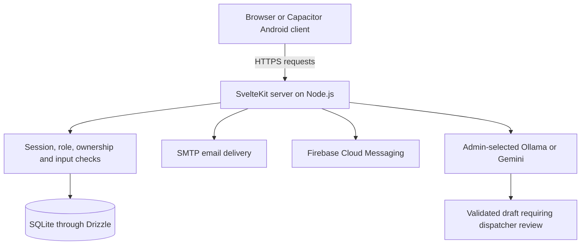

# HandLink-SOS project context

Last inspected: **21 October 2026, Asia/Manila**. Local branch: `main`. Current local HEAD after the authorship rewrite: `9966386` (`agents.md for gpt`). The original source inspection used `dc7ca4d` (`birthday fix`); that hash belongs to the pre-rewrite history. This establishes local commit state, not GitHub synchronization or production deployment.

### Local Git authorship maintenance

On 21 October 2026, all 43 commits in local `main` were rewritten to use `bananathatlikesmilk` as both author and committer, with the user's existing configured Git email. Repository-local Git configuration uses the same identity for future commits. Commit contents, messages, timestamps, and parent topology were verified unchanged. Commit IDs changed because Git includes authorship metadata in each commit's identity.

Recovery files are stored locally under `.git/history-backups/2026-10-21T01-49-07-639Z/`: a verified `before.bundle`, original metadata, and the old-to-new commit mapping with verification results. Git's original-history ref, remote-tracking refs, and internal Codex refs retain their previous history. These recovery/cache refs can still show old identities when using `git log --all`; the rewritten project history is `main`. No remote push occurred. Publishing rewritten history requires a coordinated force-push and collaborators must reconcile existing checkouts. The context/history updates recording this task remain uncommitted unless the user commits them.

## How to use this file on a phone

Share this file and [CODEX_HISTORY.md](CODEX_HISTORY.md) with ChatGPT. Ask it to teach from these records and identify uncertainty before making implementation claims. Repository links require access to the source; uploaded Markdown alone does not give ChatGPT access to the repository, server, device, database, or earlier chats.

This file describes current source. The history explains how the discussion evolved. Older guides can describe earlier implementations. Nothing here includes credentials or actual user/medical records.

### Evidence labels

- **Confirmed in source:** inspected implementation exists locally.
- **Previously verified:** tools in the available conversation, or an explicitly identified repository report, recorded a result. This is not a new test run today.
- **User-reported:** supplied by the user; not independently established for every device or deployment.
- **Proposed / open:** not confirmed as implemented or completed.

## 1. Purpose and account roles

HandLink supports emergency reporting, authorized incident handling, trusted-profile relationships, location sharing, notifications, and documentation. AI helps summarize dispatcher notes and requires human review. The application does not establish that emergency services received a telephone call or that responders arrived.

| Role       | Confirmed responsibilities and access boundaries                                                                                                                                                                                                       |
| ---------- | ------------------------------------------------------------------------------------------------------------------------------------------------------------------------------------------------------------------------------------------------------ |
| User       | Register and verify email; maintain personal, optional medical, and emergency-contact information; send SOS for self or approved trusted profiles; manage QR relationships, location sharing, notifications, permissions, and favorites.               |
| Dispatcher | Complete staff MFA; see eligible incident queues; verbally confirm and claim an incident; access its authorized details; save notes; advance status; review AI drafts; add dated information after resolution.                                         |
| Admin      | Complete staff MFA; manage staff accounts and account status; view dashboard counts and authorized reports; choose the system-wide AI provider. Admin access does not automatically grant the assigned dispatcher's full personal/medical-detail view. |

All roles use `/login`. Older role-specific login routes redirect into the shared flow. The server chooses the destination from the authenticated role and session, not a role chosen in the browser. Public signup cannot assign a staff role.

## 2. Architecture and technologies

| Layer                    | Confirmed technology / responsibility                                                                                                         |
| ------------------------ | --------------------------------------------------------------------------------------------------------------------------------------------- |
| Language and tooling     | TypeScript, pnpm, Vite, Prettier, ESLint, Playwright, and Node test runner.                                                                   |
| Web interface and server | Svelte 5 / SvelteKit 3 with adapter-node. File routes provide pages and JSON APIs.                                                            |
| Styling                  | Tailwind CSS 4, DaisyUI 5, shared appearance variables, and Lucide icons.                                                                     |
| Authentication           | Better Auth with Drizzle adapter, email/password, email verification/recovery, staff authenticator MFA, and server session checks.            |
| Database                 | SQLite via `better-sqlite3` and Drizzle ORM. It is not PostgreSQL, Firebase Firestore, or a database embedded in the APK.                     |
| Input validation         | Zod on the server; browser validation and clearer form feedback on registration/profile editing.                                              |
| Android                  | Capacitor 8; app ID `com.handlink.sos`; native Java plugins/services for permissions, GPS, dialer, overlays, and optional foreground sharing. |
| QR                       | Browser-side decoding through ZXing; server-controlled invitations and approval.                                                              |
| Email                    | Nodemailer and private SMTP configuration. Cloned source does not provide a working mail account.                                             |
| Push                     | Firebase Admin SDK on the server and Capacitor push notifications on Android.                                                                 |
| AI                       | HTTP requests to configured Ollama or Google's Gemini API. No automatic provider fallback.                                                    |
| Deployment               | Docker; production Compose with an app service and Cloudflare Tunnel. Optional Ollama and Firebase Compose extensions.                        |

These are declared major versions and inspected architecture, not a claim that every installed dependency exactly equals its package.json range.

### Main file map

| File or directory                                                                                    | What to explain or inspect there                                                             |
| ---------------------------------------------------------------------------------------------------- | -------------------------------------------------------------------------------------------- |
| `src/routes/`                                                                                        | User, Dispatcher, Admin pages, layouts, and API routes.                                      |
| `src/hooks.server.ts`                                                                                | Reads authentication sessions into request-local state and integrates Better Auth.           |
| `src/lib/server/auth.ts`                                                                             | Authentication configuration, staff MFA proof, and session-related hooks.                    |
| `src/lib/server/api.ts`                                                                              | Current-account checks, role guards, bounded JSON input reading, and private responses.      |
| `src/lib/server/validation.ts`                                                                       | Accepted input schemas and format/length rules.                                              |
| `src/lib/server/db/schema.ts` and `handlink.schema.ts`                                               | Authentication/application tables, keys, indexes, and constraints.                           |
| `src/lib/server/incidents.ts`                                                                        | SOS eligibility, creation, assignment, status, access, favorites, and cancellation rules.    |
| `src/lib/server/trusted.ts`                                                                          | QR invitations and directional trusted-profile approval.                                     |
| `src/lib/server/location-policy.ts`, `location-expiry.ts`, and sharing modules                       | Sharing eligibility, expiration, and revocation.                                             |
| `src/lib/server/ai-summaries.ts`                                                                     | AI preview, consent, source versions, request reservations, redaction, review, and auditing. |
| `src/lib/server/summary-provider.ts`, `summary-extract.ts`, `ollama-summary.ts`, `gemini-summary.ts` | Model instructions, structured output, output checks, and provider calls.                    |
| `src/lib/components/StaffWorkspace.svelte`, `Reports.svelte`, `AiReportSummary.svelte`               | Staff workflow, reports, and visible AI draft/review states.                                 |
| `src/lib/components/AuthFrame.svelte`, `AuthScreen.svelte`                                           | Shared animated authentication design and login/recovery interface.                          |
| `src/lib/user/UserProfileFields.svelte`                                                              | Shared personal, medical, and emergency-contact fields.                                      |
| `src/lib/server/registration.ts`, `src/lib/phone.ts`, `src/lib/birthday.ts`                          | Duplicate checks, canonical mobile numbers, and minimum-age rules.                           |
| `src/lib/server/input-errors.ts`, `src/lib/client/request.ts`, `form-validation.ts`                  | Safe named-field errors, request failures/timeouts, and invalid-field highlighting.          |
| `android/app/src/main/java/com/handlink/sos/`                                                        | Native Android behavior. Generated Android output is not the source to edit.                 |
| `scripts/`, `drizzle/`, `tests/`                                                                     | Startup/migration/provisioning, versioned database changes, and verification.                |

## 3. Confirmed workflows and rules

### Accounts and forms

- User registration requires configured email delivery, a valid profile, and password confirmation. Login has one password field and a show/hide control. Medical fields are optional; required personal/contact fields must be completed.
- Password policy in authentication configuration is 12–128 characters. Passwords are hashed through Better Auth; plaintext passwords are not intended for database storage or phone persistence.
- Email duplicates are checked case-insensitively. A normalized email uniqueness index exists in the database.
- Account-phone duplicates are checked across equivalent local/international formats, including during immediate write transactions. This is application-enforced phone uniqueness, not a database unique-phone index. Existing duplicates are not silently merged. Emergency contacts can share numbers.
- Phone inputs show exactly 11 local digits beginning with `09`. Valid mobile numbers are stored/sent canonically as `+639...` for compatibility. Older documentation showing an input starting with `+639` predates the current local-format UI.
- Birthdays must be real dates for someone **at least two years old**. The exact second birthday is eligible. Shared client/server helpers use the Philippine calendar date and handle leap years. Existing records are not automatically deleted or rewritten by this validation change.
- Validation failures identify fields and correction rules, including numbered emergency contacts. Registration/profile editing highlight invalid fields and retain edits after failed saves. Request helpers distinguish network failure, timeout, and server/input errors without exposing internal 500-error details.

### Trusted profiles and favorites

QR invitations use random tokens with hashed server storage, expiration, and controlled approval. Scanning does not immediately grant full access. Permission is directional: the owner approves a requester to send SOS for the owner. Reciprocal access is not automatic.

The dashboard searches approved SOS profiles by name, ignoring case and surrounding spaces. A separate star saves the requester's favorite on that trusted connection. Favorites sort first, then names alphabetically. Favorites persist across reloads/devices; they do not grant approval, transmit SOS, or share the preference with another account. Revoked/inactive relationships stop appearing as eligible targets.

### SOS and incident handling

1. The User chooses self or an approved trusted profile.
2. The reporting device obtains location.
3. A five-second cancellation countdown starts; an explicit immediate-send option can bypass the remaining countdown.
4. The client sends JSON with a retry/idempotency key.
5. The server rechecks current identity, account/profile availability, trusted permission, input, rate/duplicate rules, and prior request state.
6. An immediate database transaction records the incident and its event, with an on-behalf beneficiary notification where applicable.
7. Staff queues poll for updates, commonly every five seconds while visible. This is not a guarantee that a human has seen an alert.
8. An MFA-verified Dispatcher verbally confirms and claims an unassigned case. Ownership checks control sensitive detail access and changes.
9. Normal status progression is `Not assigned`, `In progress`, `On route`, `Resolved`.

**Location limitation:** on-behalf SOS uses the location of the device sending the alert. It does not automatically request, receive, or track the represented person's live location. Separate voluntary sharing exists but is not automatically linked to that incident.

Personal, medical, and registered emergency-contact details are limited to the assigned Dispatcher after confirmation. Reports have separate authorized oversight behavior; do not assume every report viewer gets every medical field.

Notes autosave after about 1.2 seconds of inactivity, with sequenced writes and note-version conflict handling. Resolved notes remain locked. The assigned Dispatcher can add an append-only, dated addendum; this preserves the original notes and original AI source. Cancellation requests/review are separate recorded actions rather than silent deletion of history.

### Phone handoff

Android native code uses `Intent.ACTION_DIAL` with 911 prepared. The user must press the phone's Call control. The overlay shortcut itself never sends SOS or places calls. The non-Android helper instructs the person to open their Phone app manually.

The presence of a `call_session` table is **not evidence of implemented VoIP, telephony-provider integration, automatic call placement, audio recording, or call transcription**. Inspection found its schema declaration but not an active provider-call workflow.

### AI summaries

- Admin selects Ollama or Gemini system-wide in AI settings. Keys remain server-only; dispatchers see configuration status, not credentials.
- The model receives only approved, redacted incident-note text. Backend redaction may consult known identifiers, but the model does not independently query the database or automatically receive full registered medical profiles. Medical information manually included in approved notes can still be transmitted.
- Flow: saved note version, preview/redaction, dispatcher review/consent, provider call, output validation/redaction, saved unapproved draft, dispatcher approval.
- Current generation requests a rewritten paragraph plus supporting sentence IDs. The old extractive implementation rebuilt whole source sentences and could return notes unchanged; that behavior was intentionally replaced.
- Drafts are bounded to 150 words and 1,500 characters. Source references must be valid/distinct; their ordering does not determine the order of rewritten prose. Full copies of source notes longer than 40 words are rejected. Short notes may legitimately retain similar wording.
- Instructions prohibit invented diagnosis, urgency, recommendations, and treatment. Output checks reject common newly added interpretation terms and embedded instructions. These checks and source references are not semantic fact verification; human review remains essential.
- Provider failures, invalid outputs, changed notes, revoked access, and provider changes cannot silently publish stale replacements. Previous saved summaries/history are preserved according to the request/audit workflow. Existing saved extractive drafts require regeneration to change.
- Ollama follows `OLLAMA_SERVER_URL`. Only an absent setting defaults to localhost; empty/invalid values are configuration errors. HTTP(S) origins cannot include credentials, extra paths, queries, fragments, or redirects. A specific private IP is not hard-coded as the only supported destination.
- Default local model: `qwen2.5:3b`. Gemini's configured model is read from private environment configuration; the source default is `gemini-3.5-flash-lite`. Current production values were not read for this record.

### Notifications, sharing, permissions, and Android

Notifications are database records; Android push delivery is a separate Firebase-backed process with eligibility checks and delivery state. Opening the User Updates page marks loaded notifications read. Notification permission does not guarantee immediate delivery or human attention.

Location sharing is permission-aware, opt-in, recipient-controlled, and time-limited. Expiration/revocation rules matter independently of location permission. The Android foreground location service and floating overlay are implemented, but OS restrictions, permission changes, force-stop, and battery management limit background behavior guarantees.

Settings provide location/camera/overlay controls. Android may require opening system settings to change a granted or blocked permission. QR scanning stops camera tracks after success/visibility changes/navigation. The compact four-dot floating shortcut opens the User dashboard and does not capture screen contents or automatically trigger emergency actions.

User sessions use persistent HttpOnly cookies; continued validity still depends on expiry, logout, password reset, revocation, account state, and device storage. Closing the app is not itself a request to log out. Android APKs are not iOS installation packages; a schema enum mentioning iOS does not establish a completed iOS client.

## 4. Database structure

Source of truth: `src/lib/server/db/schema.ts`, `handlink.schema.ts`, and applied migrations. Foreign keys relate records; immediate transactions serialize critical writes. Data is relational even though SQLite uses a file.

| Table group                  | Tables and purpose                                                                                                                                                                                                                |
| ---------------------------- | --------------------------------------------------------------------------------------------------------------------------------------------------------------------------------------------------------------------------------- |
| Authentication               | `user`, `account`, `session`, `verification`, `two_factor`: identities, credential/provider records, sessions, verification, and MFA.                                                                                             |
| Bootstrap and administration | `seed_history` records one-time provisioning; `account_audit` records management actions; `ai_provider_setting` stores the system-wide provider selection/revision.                                                               |
| User information             | `user_profile` references `user`; `medical_profile` references the profile; `emergency_contact` references the profile and can hold controlled linked-account information.                                                        |
| Trusted access               | `qr_invitation`, `trusted_connection`, `verification_request`: invitations, directional approval/revocation, relationships, and verification workflows. `trusted_connection.requester_favorite` stores personal SOS favorites.    |
| Incidents                    | `incident`, `incident_reference`, `incident_event`, `incident_addendum`, `incident_cancellation`: caller/beneficiary, coordinates, status, human-readable reference, timeline, note history, addenda, and cancellation decisions. |
| AI/reporting                 | `ai_summary_request` records generation/version/request state; `report` stores the resulting summary and review linkage. Incident reports also derive information from incidents/events.                                          |
| Location                     | `location_session`, `location_recipient`, `location_point`: sharing ownership, permitted recipients, expiration/revocation, and reported points.                                                                                  |
| Notifications                | `device`, `notification`, `push_delivery`: session-linked device registrations, User notifications, delivery attempts/leases/states. These tables contain private identifiers and must not be exported into context files.        |
| Other schema                 | `call_session` is schema-only scaffolding for potential provider calls; `task` is an existing starter table, not a central SOS feature.                                                                                           |

Migrations are committed from `0000` through **`0013_sos_favorites.sql`**, registered in `drizzle/meta/_journal.json`. Notable later changes include staff MFA, account management, cancellation, AI reports, short incident references, Android push, seed history, incident addenda, AI-provider settings, and SOS favorites.

`scripts/migrate.mjs` backs up existing databases into ignored `.db-backups`, applies migrations, and checks foreign keys. `scripts/seed.ts` seeds the initial Admin once using `seed_history` and an immediate transaction. The bootstrap Admin is email-verified by provisioning; staff MFA still applies. This differs from the separate interactive admin-creation path described in older docs. Never infer that a local Admin exists on the production database.

## 5. Configuration and deployment state

Private environment variable **names**, not values, relevant to operators include `DATABASE_URL`, `ORIGIN`, `BETTER_AUTH_SECRET`, the SMTP settings, `SEED_ADMIN_NAME`, `SEED_ADMIN_EMAIL`, `SEED_ADMIN_PASSWORD`, `OLLAMA_SERVER_URL`, `OLLAMA_SUMMARY_MODEL`, `GEMINI_API_KEY`, `GEMINI_SUMMARY_MODEL`, `FIREBASE_SERVICE_ACCOUNT_FILE`, and `CLOUDFLARE_TUNNEL_TOKEN`.

The actual Firebase credential setting is `FIREBASE_SERVICE_ACCOUNT_FILE`. A service-account JSON is not interchangeable with a public Firebase configuration or a Gemini API key. A host file must be mounted and referenced by its container-visible path. Do not record its contents or actual path here.

`HANDLINK_MOBILE_SERVER_URL` is a mobile preparation/build input. The APK loads the configured HandLink server; secrets and the server database are not supposed to be bundled into the client. Debug localhost can use ADB reverse forwarding; a hosted HTTPS URL removes that USB dependency but still needs connectivity and a running server. Native plugin/icon changes require a rebuilt APK; hosted web changes require deployment of the web application.

Production Compose keeps persistent data under `/app/data`; the production bind mount is `./data:/app/data`. `compose.yaml` uses its own local Docker data arrangement. Local development, local Docker, and the remote server can therefore have different databases. Retain the correct persistent volume when updating.

Runtime startup applies migrations/provisioning through the container entrypoint and starts the Node server through `scripts/start-server.mjs`. The launcher uses server-controlled runtime origin settings. Cloudflare Tunnel forwards to the app service. Source includes a GitHub Actions Docker build/publish workflow, but repository code does not prove a workflow succeeded or the server pulled its new image.

Public deployment discussed by the user: `https://thebois.fyi`. Intended GitHub repository discussed: `bananathatlikesmilk/HandLinkSOS`. Neither the remote runtime revision nor remote administrator identity was verified in this documentation task.

## 6. Bugs, limitations, and unresolved work

| State                       | Item                                                                                                                                                                                                                                                                                        |
| --------------------------- | ------------------------------------------------------------------------------------------------------------------------------------------------------------------------------------------------------------------------------------------------------------------------------------------- |
| Implemented fix             | Shared animated welcome/login/registration styling, readable light-mode fields, and stronger background visibility.                                                                                                                                                                         |
| Implemented fix             | Duplicate-account email/phone checks, 11-digit local mobile input, precise input errors, and minimum birthday age of two.                                                                                                                                                                   |
| Implemented fix             | Rewritten AI summaries and stronger visible AI draft/review labeling. Real-model checks used fictional data; live Gemini was not verified in this conversation.                                                                                                                             |
| Implemented feature         | Account-scoped SOS favorites/search, migration 0013, and isolation/revocation checks.                                                                                                                                                                                                       |
| Known limitation            | On-behalf SOS does not track the represented person's location; only the reporting device's captured location is attached. Linking a recipient's separately consented live location would require a new, reviewed design. No such feature was authorized/implemented after the explanation. |
| Device/network dependent    | APK SSL failures were reported. Existing Android documentation records a network-filter diagnosis for one incident; the user also reported success on another network. Do not generalize that cause to every phone or disable TLS verification.                                             |
| Deployment unverified       | Production SMTP, Firebase credentials, current AI provider/model, Admin provisioning, deployed revision, current APK build timestamp, and GitHub/CI synchronization require operator/runtime evidence.                                                                                      |
| Verification concern        | Browser and test builds can race while generating shared configuration. The birthday task encountered trailing data in generated `node_modules/$app/tsconfig.json`; repair and sequential checks passed. Avoid concurrent sync/build mutations of shared generated files.                   |
| Historical security concern | Credentials were pasted in earlier user-supplied context. They are intentionally omitted. Revocation/rotation status is unknown and needs operator confirmation.                                                                                                                            |
| Documentation drift         | Some README/database/usability/defense-guide passages predate shared login, current phone formatting, provider selection, rewritten AI summaries, precise errors, and age rules. Consult current source and the latest context/history before quoting them.                                 |
| Not established             | Production load capacity, formal ISO certification, universal accessibility/usability, uninterrupted Android background services, guaranteed push delivery, a full native iOS application, and actual telephone-call completion.                                                            |

Potential future work must be labeled as a proposal until the user authorizes it. There is no confirmed unfinished implementation request after the age rule; the current task is portable documentation and future record maintenance.

## 7. Verification and progress

Earlier in this available conversation, focused tool runs reported:

- Authentication-screen browser checks, including role routing/MFA, registration, and light-mode readability.
- Duplicate registration/profile checks, equivalent phone normalization, concurrent-phone saves, and frontend feedback.
- Six AI extraction/draft/privacy unit checks and twelve API/browser checks across runs, including opt-in local Ollama tests with fictional data. A too-literal injury-denial assertion was corrected to accept equivalent wording, then its live quality test passed. Gemini calls remained mocked.
- Favorites migration preservation, requester isolation, UI filtering/sorting/reload, failed-save handling, and a nearby on-behalf incident workflow.
- Clear-error unit/API/browser tests, retained profile edits, and connection/timeout explanations.
- Four birthday/error unit checks and three focused birthday/registration API/browser checks. Type checking, lint, formatting, and applicable Svelte autofixer checks passed after generated-config repair.

These are historical focused results, not a claim that the full suite was rerun during this records-only task. Tests do not certify production configuration, medical accuracy, every handset, or scale.

Useful commands are `pnpm check`, `pnpm build`, targeted `node --test ...`, and the relevant Playwright configuration. Use isolated test databases and fake credentials. Run check/build generation sequentially when they share generated files. Avoid database mutation, network AI calls, or device actions solely to refresh these records.

## 8. Teaching and continuation notes

The user is preparing to defend a capstone and prefers simple explanations, small code blocks, analogies, and one practice question at a time. They have practiced authentication, authorization, validation, HTTP status codes, trimming, Boolean conditions, session expiry, ownership, and incident creation. Continue checking understanding rather than assuming mastery.

The photographed evaluation rubric allocates 75 points to functionality, UX, technical implementation, selected ISO 25010 quality areas, and problem–solution fit (15 each). Presentation contributes 25: clarity 5, communication 5, question handling 5, professionalism 10. Explain quality alignment with evidence, not a claim of formal ISO certification.

Existing teaching artifacts are under [docs/defense-guide](docs/defense-guide/README.md), including a DOCX, authored Markdown, generated index, and flowcharts. Their presence is confirmed, but the guide was not regenerated in this task and may describe earlier behavior.

Latest unresolved practice prompt from the conversation: if a User changes an incident ID in the URL, what server-side ownership/access checks should run? No answer to that prompt is available after it was asked. See the history for earlier quiz corrections and explanations.
