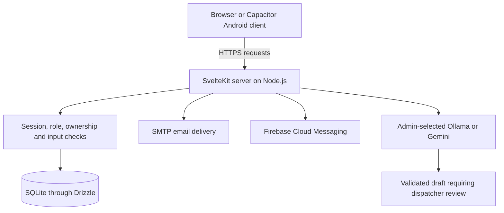

# HandLink-SOS project context

Last inspected: **5 November 2026, Asia/Manila**. Local branch: `main`; inspected baseline HEAD: `901dcd7` (`phone number hotline fix`). Stranger SOS below is new local work. Earlier inspections used the commits recorded in the historical notes below. No new GitHub synchronization or production deployment was verified.

### Local Git authorship maintenance

On 21 October 2026, all 43 commits in local `main` were rewritten to use `bananathatlikesmilk` as both author and committer, with the user's existing configured Git email. Repository-local Git configuration uses the same identity for future commits. Commit contents, messages, timestamps, and parent topology were verified unchanged. Commit IDs changed because Git includes authorship metadata in each commit's identity.

Recovery files are stored locally under `.git/history-backups/2026-10-21T01-49-07-639Z/`: a verified `before.bundle`, original metadata, and the old-to-new commit mapping with verification results. Git's original-history ref, remote-tracking refs, and internal Codex refs retain their previous history. These recovery/cache refs can still show old identities when using `git log --all`; the rewritten project history is `main`. No remote push occurred. Publishing rewritten history requires a coordinated force-push and collaborators must reconcile existing checkouts. The context/history updates recording this task remain uncommitted unless the user commits them.

## How to use this file on a phone

**Python troubleshooting, 21 October 2026:** A later local inspection found only Windows Store aliases for `python`/`python3`; `py` and `pip` were not on PATH. The user's `winget install Python.Python` found no matching package. No Python installation or additional history rewrite was performed. Local `main` at `11d905b` already uses the requested author and committer identity throughout; installing Python is unnecessary for the completed authorship task. This inspection did not query the remote.

**ChatGPT synchronization limitation (21 October 2026):** Repository instructions require future relevant Codex sessions to maintain these local records. This is not a background synchronization service. No available connected tool or discovered plugin provides upload/replacement of files inside the user's ChatGPT Project. No automatic sync was configured. For now, replace the uploaded context/history files manually when using the phone. Official documentation distinguishes local folder access from ChatGPT Project sources: [Projects and chats](https://learn.chatgpt.com/docs/projects).

**Git publishing update, 21 October 2026:** The user committed the authorship-maintenance records and explicitly authorized a force-push. Published local `main` at `3f48759` to `origin/main` using an explicit force-with-lease against the previously observed remote commit. A fresh remote query confirmed the matching full commit ID. All 44 published commits use `bananathatlikesmilk` as author and committer. This supersedes the earlier unpushed/uncommitted status above; it does not verify production deployment. The records of this publishing action remain local, uncommitted edits.

Share this file and [CODEX_HISTORY.md](CODEX_HISTORY.md) with ChatGPT. Ask it to teach from these records and identify uncertainty before making implementation claims. Repository links require access to the source; uploaded Markdown alone does not give ChatGPT access to the repository, server, device, database, or earlier chats.

This file describes current source. The history explains how the discussion evolved. Older guides can describe earlier implementations. Nothing here includes credentials or actual user/medical records.

### Evidence labels

- **Confirmed in source:** inspected implementation exists locally.
- **Previously verified:** tools in the available conversation, or an explicitly identified repository report, recorded a result. This is not a new test run today.
- **User-reported:** supplied by the user; not independently established for every device or deployment.
- **Proposed / open:** not confirmed as implemented or completed.

## 1. Purpose and account roles

### Light/dark appearance transition, 5 November 2026

The shared [ThemeToggle.svelte](src/lib/components/ThemeToggle.svelte) now enables a temporary appearance-transition marker when the User, Admin, or Dispatcher changes theme, including a synchronized change from another browser tab. [layout.css](src/routes/layout.css) fades background, text, border, outline, SVG fill/stroke, and shadow colors over 280 milliseconds. The marker clears after 350 milliseconds; repeated switches restart its cleanup timer, and component cleanup removes it. It does not permanently replace ordinary hover transitions or animate layout dimensions. Initial preference loading remains instant, saved appearance behavior remains, and the button stays an accessible icon-only control. Both JavaScript and CSS respect reduced-motion preferences. This is local web styling/component work, with no native Android method, database migration, publishing, or deployment performed. See H061 for verification.

### SOS for an unregistered person, 5 November 2026

**Confirmed local implementation:** A signed-in User with a saved active profile can select **SOS for someone I don't know** on the dashboard. The person needing help does not need an account, QR invitation, or trusted connection. This is identified reporting, not anonymous/public SOS. The reporter enters what happened (required, at most 1,000 characters), an optional name (at most 100 characters; blank displays Unknown person), and the emergency location. Choosing “I'm with them” uses the reporting device's GPS after permission checks. Choosing “I'm elsewhere” requires an address/landmark (at most 250 characters) and sends no device GPS. Address-only reports receive no automatic municipality suggestion; provincial dispatch confirms the municipality with the caller. There is no address geocoding or map-pin picker in this first version.

The existing five-second countdown, immediate-send control, cancellation before sending, saved-request recovery, account/minute limits, incident references, provincial ownership, configured hotline, and user-controlled phone Call action remain. Retries compare the entire submitted incident identity/location/description and use the same idempotency key. Separate unknown people are not merged or automatically rejected as duplicates. The earlier registered-profile active-SOS rule remains for self/trusted cases. Related-report linking is a possible future improvement, not implemented here.

**Identity and access invariant:** A stranger incident has a null `person_profile_id`; it never uses the reporter as a placeholder beneficiary and does not create a fake account/profile. Reporter name, phone, and authenticated account remain separate. Dispatch and reports explicitly label the incident as for an unregistered person and show caller-reported, unverified information. No registered medical profile, emergency contacts, beneficiary notification, or beneficiary cancellation identity is attached. Names are claims, not automatic account matches. The assigned provincial dispatcher still verbally confirms the caller, saves/version-controls notes, records externally confirmed progress, and can use the existing reviewed AI-summary and report/addendum paths. The summary redaction path now handles an absent beneficiary and includes any supplied stranger name among known identifiers; it does not query a nonexistent medical profile. The original caller description remains distinct from dispatcher notes.

Reports support the additional **For an unregistered person** filter. PDF exports identify reporter and subject separately and include the original caller description and its location source. Trusted-only report filtering excludes strangers. Self/trusted location-sharing consent and snapshots remain unchanged. HandLink does not locate a stranger's phone, answer/record calls, contact municipal hotlines, dispatch units, or infer response status. Calls and municipal coordination remain external.

**Storage and rollout:** [0019_stranger_sos.sql](drizzle/0019_stranger_sos.sql) rebuilds the incident parent table transactionally to permit a null beneficiary and address-only coordinates, adds description/name/location-source fields, copies old incident data, and recreates its indexes/reference-allocation trigger. Existing child rows and immutable references remain. A foreign-key integrity assertion runs before deferred constraint bookkeeping is cleared. Registered/device-location cases still require valid coordinate pairs; address-only stranger cases can store null coordinates. Source readers use left joins so stranger cases cannot vanish from lists/reports. Use the existing backup-producing migration command before starting the updated server. Deploy all server instances consistently; older readers cannot safely handle new stranger rows. After new stranger writes, prefer a forward fix rather than an old-code downgrade or a backup restore that discards incidents. No production migration, deployment, push, APK rebuild, physical-device check, or actual emergency call was performed. This feature adds web/server behavior and no native Android method.

Sources: [SOS screen](src/routes/user/sos/+page.svelte), [incident validation](src/lib/server/validation.ts), [incident service](src/lib/server/incidents.ts), [staff workspace](src/lib/components/StaffWorkspace.svelte), [reports](src/lib/components/Reports.svelte), [PDF renderer](src/lib/server/report-pdf.ts), and [focused tests](tests/stranger.api.ts). Verification results are recorded in H060 after execution; local source is not evidence of deployment.

**Local verification:** All 23 database tests and 19 focused API/browser cases passed across the recorded runs. The final three stranger cases passed again after mobile presentation corrections, including updated confirmation wording, readable light/dark buttons, lost-response retry without duplication, staff ownership/medical isolation, notes and AI preview, filtered PDF content, and mocked native dialer handoff. Production builds completed. Mobile form/staff screenshots were inspected and 390-pixel overflow checks passed. These checks use fictional records, isolated databases and a native bridge mock, not actual emergency calls or physical-device installation.

### Admin-configurable SOS phone number, 5 November 2026

Central Admin can change the installation-wide phone number at **SOS phone number** (`/admin/emergency-phone`). It defaults to `911` until saved. The setting persists in SQLite with the updating Admin and timestamp; local LGU Admins, Dispatchers and Users cannot change it. Migration `0018_emergency_phone.sql` adds the singleton table without changing existing incidents or authentication records. Input accepts 3–15 ASCII digits with an optional leading plus; extensions, USSD, URI/intent fragments, spaces inside numbers and executable syntax are rejected. Format validation does not verify the number belongs to an emergency office.

The `/user/call` screen loads the server's current number and, after the 5 November freshness correction, refreshes it every five seconds while visible and on window focus/visibility return. Native dialer handoff and explicit web dialer clicks also fetch the current hotline from the authenticated, no-store `/api/emergency-phone` endpoint immediately before opening. A failed verification blocks opening a potentially outdated number and shows a retry message; the displayed number may be stale while offline. The dialer still requires the user to press Call; web has no automatic phone navigation, and cancellation/reload handoff behavior remains. An already-open phone dialer is outside HandLink and cannot be rewritten by an Admin change. This number is a telephone destination, separate from GPS suggestions and provincial case ownership.

The Android plugin adds `openDialerWithNumber` and validates the number again before creating ACTION_DIAL. Existing `openDialer` remains 911-only for older clients/default compatibility. New web code calls the new method for custom numbers; old APKs missing that method fail with manual-number/update instructions rather than silently opening 911. Users need the updated APK for native custom-number support. The local debug APK is `android/app/build/outputs/apk/debug/handlink-dynamic-sos-number-2026-11-05.apk`, targets `https://thebois.fyi/user`, and its signature was verified. SHA256: `7A6050F1744A50E89C766A94DB53E6EAAA3888E4315311B78E12D88D015C81D7`. No device installation or physical dialer test was performed. Server deployment/migration remain unverified.

**Verification:** All 22 database tests and six focused settings/dialer API/browser cases passed. Production build, Android compilation/debug assembly, APK signature, type checks, targeted ESLint and formatting checks passed. Tests cover role/MFA/origin restrictions, unsafe-number rejection, saved-setting persistence/UI, web intent values, native payload on saved SOS, no repeat on reload, legacy APK behavior and existing default dialer safety. A first run failed in test cleanup when reusing a staff login; corrected isolated fixture cleanup and reran all six successfully.

### Trusted-profile SOS location correction, 5 November 2026

**Local verification:** All nine focused location/export cases passed across the initial run and corrected beneficiary-case rerun. Production builds, zero-error/zero-warning type checks, targeted ESLint, formatting and diff checks passed. Tests cover dispatch/coordination/report/PDF location fields, sender-coordinate omission, snapshot stability, sharing eligibility failures and self-SOS preservation. Deployment and device behavior remain unverified.

The user requested dispatch receive the trusted person's location rather than the sender's. The server already captured an authorized beneficiary shared-location snapshot, but staff API coordinates still represented the sender and PDFs displayed both. Staff detail, provincial coordination and report APIs now project trusted-person coordinates from `incident_person_location`; if no snapshot exists, coordinates are null and the location label is empty. The shared dispatch/report location panel and PDF show only the beneficiary's snapshot for trusted-person SOS, including its time and accuracy. Self-SOS continues to show the sender's reported location. This supersedes earlier documentation about showing both locations to staff.

Existing sharing consent, recipient eligibility, expiry/revocation and GPS suggestion freshness rules remain. A trusted relationship alone does not authorize remote GPS retrieval or start sharing. The trusted person needs an eligible sharing session with the sender when SOS is saved. A historical snapshot is not live tracking and may be older than the five-minute automatic suggestion threshold; it remains labeled with its recorded time. Without a snapshot, dispatch must confirm the emergency location verbally; sender coordinates are never a fallback. Original sender coordinates remain stored for incident creation/idempotency compatibility and historical preservation, but are omitted from structured staff location responses, location panels and PDFs for trusted-person SOS. User-entered notes are not automatically scrubbed of coordinates. No schema migration is needed.

### Current local workflow: provincial case handling with external calls, 4 November 2026

The user explicitly confirmed that HandLink supplies caller/beneficiary information, available location, incident notes and manually recorded progress. The office's own call equipment answers the caller. Staff contact municipal hotlines and verbally relay needed information outside HandLink; municipal operations contact fire/EMS/police through their existing procedures. HandLink does not transport voice, call municipalities, forward profiles, dispatch responders, or track them automatically. Municipal staff do not need to accept these cases in HandLink.

New SOS remains in the existing `provincial-intake` queue. The handling provincial dispatcher confirms the caller, atomically claims the incident and receives authorized personal/medical/contact information. Only that assigned dispatcher can edit notes, record response status, review beneficiary cancellation, manage AI drafts, or add report addenda. Other provincial staff and central Admin have operational oversight without access to the registered medical/profile/contact panels. Municipal staff cannot obtain these cases or reports by queue search, direct ID, confirmation or export. Both routing APIs reject transfer of provincial cases, including before confirmation.

Provincial ownership uses the saved incident queue; no new database column or migration was necessary for this correction. `incident-workflow.ts` centralizes the distinction between provincial cases and earlier municipal/legacy cases. Cases already assigned to municipal queues remain there with their existing handlers and workflow. Pending cases still in provincial intake can now be handled there. The existing `0017_provincial_intake.sql` migration remains required on servers that do not yet have that queue/suggestion table. Do not mix old handoff servers with the corrected ownership rules during rollout.

Staff UI labels provincial `Not assigned` as **Received** and `In progress` as **Coordinating**; underlying database/API statuses remain compatible. **On route** and **Resolved** require the handling dispatcher to enter who confirmed the update and the confirmed details/outcome. The server records those details with actor and time in existing append-only incident events. A placed hotline call never changes status automatically. Closing a case without sending responders is allowed after a documented confirmed outcome; it does not require inventing an On route event. Pending beneficiary cancellation must still be reviewed first. On-scene updates can be recorded in notes; no new On scene database status was added. Confirmation/update records are operator attestations, not independently verified telephone evidence.

The alerts workspace and reports show confirmed response history and its last recorded time. PDF exports include that history, its source/details, recording staff and timestamps. Existing note autosave, version conflicts, MFA, beneficiary location consent/freshness, dialer behavior and immutable resolved-note/addendum rules remain. Use notes to record contacted office, relevant briefing, municipal acknowledgment and later information. There is no electronic municipal acceptance or automated transmission to another agency.

**Local verification, 4 November:** All 21 database tests passed. Across the 40-case regression run and corrected final provincial-test rerun, all 40 distinct focused API/browser cases passed. Production builds, zero-error/zero-warning Svelte/TypeScript checks, targeted ESLint, formatting and diff checks passed. Provincial tests cover ownership, privacy, no municipal transfer, source-required updates, audit rollback, confirmed no-response closure, cancellation, PDF text and addenda. Mobile light/dark screenshots were visually inspected; the 390px horizontal-overflow check passed. These are local tests, not live-server or physical-device verification. Svelte MCP/autofixer was unavailable and was not claimed as run. No new publishing/deployment occurred.

### Earlier workflow clarification, 3 November 2026 (historical; implemented as described above)

**US 911 comparison (official-source explanation):** US emergency-center staffing and dispatch arrangements vary. A common pattern separates call-taking from radio/resource dispatch while both staff use one computer-aided dispatch (CAD) incident record; these can be coworkers in one center, not necessarily provincial and municipal tiers. Dispatchers obtain responder status through radio and connected field computers rather than inferring departure/arrival/completion from the caller's telephone call ending. For HandLink's proposed external-hotline operation, municipal acknowledgment and reported response progress would need recorded updates until an actual integration exists. Proposed Verifying/Coordinating/On scene stages are not current implemented status values. Sources: [911.gov FAQ](https://www.911.gov/calling-911/frequently-asked-questions/), [Cincinnati ECC](https://www.cincinnati-oh.gov/ecc/about-ecc/), and [Richmond 911 process](https://www.rva.gov/911/active-live-events-feed-and-stats), consulted 3 November 2026.

**Further clarification:** The user proposed that provincial dispatch remains on the caller's emergency call, verifies identity and details through HandLink, records additional incident information, and contacts the municipality through its official hotline. Municipal operations then contact the appropriate fire/EMS/police service. Recommend sharing an incident-specific briefing rather than the entire registered profile: verified emergency location, what happened, hazards, assistance needed, and relevant medical facts or callback information when needed. Do not automatically disclose unrelated medical history, full profile fields, or the emergency-contact list. Municipal staff do not necessarily need HandLink accounts for this telephone-based coordination model. Confirmation, contacts, municipal acknowledgment, updates and resolution should be recorded against the provincial dispatcher's case. These are proposed requirements; the current municipal-ownership implementation has not been changed. HandLink currently receives app SOS records and provides a telephone dialer handoff; it does not receive or answer 911 calls or operate a call center. Telephone handling remains on the office's official equipment unless deliberately integrated later.

After the provincial-intake implementation below, the user clarified that provincial dispatchers should handle incoming reports and coordinate municipalities until resolution. The intended model is a provincial coordination desk: Admin oversees the service; the handling provincial dispatcher remains responsible for the incident and requests municipal response. Municipal teams provide response and progress information. Their need for separate in-app dispatcher accounts, acceptance authority, and update permissions remains to be settled. Do not assume a second municipal call-taking desk or require the caller to repeat the report.

This differs from the current local implementation, which assigns handling ownership to a municipal dispatcher and gives provincial dispatch read-only response monitoring. The user's clarification is recorded as a proposed adjustment, not a completed code change. The earlier implementation/testing record remains valid for that earlier model. A 911-style coordination analogy helps explain responsibilities, but actual emergency-center organization varies; no equivalence to a particular US or Philippine operating procedure was verified.

### Initial provincial handoff implementation, 3 November 2026 (historical; ownership superseded above)

The following describes the earlier implementation and its checks. The 4 November correction above replaces municipal handoff for cases in provincial intake; existing municipal cases remain compatible.

The user approved and requested implementation of provincial dispatch receiving every new app SOS first. New incidents now enter the permanent **Provincial coordination (system)** queue (`provincial-intake`). GPS computes and stores a municipality suggestion and reason; it no longer sends new SOS directly to municipal dispatch. Missing, stale, overlapping, outside, or unconfigured boundary results remain visible for human review. The beneficiary-location consent/freshness checks remain unchanged.

The current central Admin provides provincial oversight. Central Admins can create or move Dispatcher accounts into the provincial queue through Manage accounts; the same assignment system creates municipal staff in their own LGU. Provincial dispatchers use `/dispatch`, complete existing email verification/MFA, and see all incident summaries, coordination locations, municipal notes, assignment history and response progress. They cannot manage accounts/LGUs/AI settings or claim/change municipal responses. Registered medical, personal and emergency-contact details remain restricted to the assigned municipal dispatcher. Operational notes may contain sensitive information, so provincial access is an explicit operational responsibility, not public access.

Provincial dispatch confirms the caller and emergency location, chooses an active municipality, and records an audited assignment. The municipal queue then receives the same incident. **Accept and confirm incident** uses the existing atomic confirmation/ownership transition; one municipal dispatcher wins acceptance, then updates notes and response status. Provincial filters distinguish awaiting assignment, awaiting municipal acceptance, and accepted cases. Existing five-second visible-page refresh keeps progress current. New assignment requests reject stale destination changes and prohibit transfer after municipal acceptance. Repeated assignment to the same still-unaccepted destination does not duplicate its audit record.

Migration `0017_provincial_intake.sql` adds the system queue and `incident_intake` suggestion table. Existing incidents, staff assignments, references, notes, and handling ownership remain unchanged; the migration does not move historical cases into provincial intake. Deployment must apply migrations and prepare a staffed provincial queue before real SOS use. This is local source, not verified production behavior. No automatic telephone/Facebook intake, responder dispatch, in-app agency messaging, or transfer of claimed cases was added. See [the setup and workflow guide](docs/multi-lgu.md).

**Local verification:** All 21 database tests passed. Across a broader run and corrected downstream-fixture reruns, 46 distinct focused API/browser cases passed. The final provincial test additionally passed coordination-stage filters, assignment audit rollback, 390px layout without horizontal overflow, and light/dark screenshots; desktop and mobile screenshots were visually inspected. Production builds, Svelte/TypeScript checks and targeted formatting/lint checks passed. Svelte MCP/autofixer was unavailable; it was not claimed as run. No production database, server deployment or physical device was verified.

### Initial multi-LGU implementation, 31 October 2026 (historical routing)

The following records the initial direct-routing implementation. The 3 November provincial-first update above supersedes its new-SOS routing behavior; LGU isolation and historical ownership protections remain.

The user confirmed GPS-boundary routing and a central Admin with isolated LGU administrators and dispatchers. No first LGUs are chosen yet. Central Admins can add inactive drafts, import or paste GeoJSON boundaries, prepare staff assignments, and activate them through **LGUs and routing** at `/admin/lgus`. See [the multi-LGU setup guide](docs/multi-lgu.md) for operation, limits, and deployment precautions.

**LGU form explanation, 2 November 2026:** GeoJSON describes the LGU's full geographic border, which the server uses to check emergency GPS positions. Import GeoJSON boundary and Boundary GeoJSON are two ways to provide the same content; file import fills the text box. Polygon supports one area, MultiPolygon supports separated areas, and a Feature can wrap the geometry. Operators need an LGU name, an official WGS84 municipality/city boundary for one LGU, and prepared staff before activation. Ask the relevant LGU planning/GIS office for the boundary; no actual jurisdiction file was obtained or invented in this discussion. Inactive drafts can be saved while preparing these inputs. See docs/multi-lgu.md for format and size limits.

Migration `0015_multi_lgu.sql` preserves existing incidents and dispatchers under **Existing LGU** (`legacy`); existing Admins retain central access. New app-created staff always receive an LGU assignment. Scoped staff queues, direct-ID incident operations, reports/AI operations, account administration, and dashboard counts enforce their LGU on the server. Global AI configuration and LGU management remain central-only. Existing MFA, consent, and assigned-dispatcher medical-detail restrictions remain.

Before the first boundary activation, draft preparation preserves the active legacy workflow. After activation, new self-SOS routes using reported GPS; trusted-person SOS requires an eligible shared beneficiary point no older than five minutes. Missing/stale beneficiary GPS never uses the caller's position for routing. Overlapping boundaries, outside points, and unavailable beneficiary locations go to central review. Disabling previously activated boundaries does not restore legacy routing. Historical location snapshots may be older, but cannot determine automatic routing after that freshness limit.

Incident LGU is saved at creation. Central Admins can manually route only unassigned cases, with an audit entry. Staff reassignment ends existing sessions and blocks moves with unresolved assigned incidents. LGU deactivation is blocked while unresolved cases remain. Existing records are preserved; no actual jurisdiction boundaries are bundled. This selects the incident queue, not a telephone destination. Production migration/deployment and real-boundary setup remain outstanding.

HandLink supports emergency reporting, authorized incident handling, trusted-profile relationships, location sharing, notifications, and documentation. AI helps summarize dispatcher notes and requires human review. The application does not establish that emergency services received a telephone call or that responders arrived.

| Role       | Confirmed responsibilities and access boundaries                                                                                                                                                                                         |
| ---------- | ---------------------------------------------------------------------------------------------------------------------------------------------------------------------------------------------------------------------------------------- |
| User       | Register and verify email; maintain personal, optional medical, and emergency-contact information; send SOS for self or approved trusted profiles; manage QR relationships, location sharing, notifications, permissions, and favorites. |
| Dispatcher | Complete staff MFA; work only within the assigned active LGU; confirm and claim cases; access authorized details; save notes; advance status; review AI drafts; add dated information after resolution.                                  |
| Admin      | Central Admins manage LGUs, installation-wide staff oversight and the global AI provider. LGU Admins manage their own staff, reports and counts. Neither bypasses assigned-dispatcher medical-detail restrictions.                       |

All roles use `/login`. Older role-specific login routes redirect into the shared flow. The server chooses the destination from the authenticated role and session, not a role chosen in the browser. Public signup cannot assign a staff role.

**Emergency-use memo, 26 October 2026 (local source):** After a successful interactive login, the shared `AuthScreen.svelte` shows an emergency-only warning for Users, Dispatchers, and Admins. Staff with MFA see it after successful code verification. It prohibits prank SOS alerts, false reports, and test emergencies, asks for accurate details, and explains that misuse can delay urgent help. The user clicks “I understand. Continue” before the normal role-based navigation. Focus moves to the memo heading; light/dark styling and mobile layout are supported. Existing saved sessions continue normally without repeating the login flow. This is a client-side warning, not a server-enforced compliance gate, recorded agreement, or automatic penalty mechanism. Direct navigation or a reload after authentication can use the already established session; no acknowledgment is stored in the database.

**Emergency-use notice visual refresh, 1 November 2026:** The user requested a nicer proper-use notification. Restyled the existing shared post-login notice in `AuthScreen.svelte` as a readable card with a shield header, three icon-led rules, an amber reminder, and a large I understand. Continue button. Added distinct light/dark surfaces and a wider notice layout while keeping ordinary login/recovery layouts intact. Preserved every original warning statement, acknowledgment behavior, heading focus, role-based destination, MFA ordering, and saved-session behavior. No new push notification, legal agreement record, timer, or server compliance gate was added. Existing User/Admin/Dispatcher login and mobile light/dark screenshot checks passed; screenshots were visually reviewed. Hosted web deployment is required to show the change.

**LGU operational coordination recommendation, 2 November 2026 (proposed):** The user restated the existing central Admin/LGU Admin/local Dispatcher hierarchy and asked about border emergencies, closer units, and police/EMS/fire coordination. Recommended a hybrid: HandLink records/routes incidents and tracks their ownership/notes/status, while dispatchers use their agencies' existing authorized response channels initially. Jurisdiction routing and choosing an available response unit are different decisions. Assistance from a neighboring LGU does not automatically transfer case responsibility; an explicit accepted handoff and history would be needed for a future structured in-app workflow. No nearest-unit dispatch, responder fleet, agency job delivery, or claimed-case inter-LGU handoff is implemented. Current central rerouting remains unassigned-only, and existing medical-detail access rules remain. See docs/multi-lgu.md for the recommendation; no feature or official mutual-aid agreement was added or verified.

## 2. Architecture and technologies

**Routing decision and implementation, 3 November 2026:** The user selected provincial-first intake for every app SOS, with GPS suggesting its municipality, then requested implementation. This is now implemented locally as described in section 1. Production deployment remains unverified.

**Provincial organization:** Central Admin provides provincial oversight; provincial dispatchers coordinate app-SOS assignment and municipal dispatchers handle accepted incidents. Municipal Admins oversee their own staff and reports. One shared incident/reference connects intake and response. Automatic 911/Facebook ingestion and manual telephone/Facebook intake remain future work. Existing authorized phone/radio channels coordinate actual responders. See [the current workflow](docs/multi-lgu.md#current-workflow-provincial-intake-first-3-november-2026).

| Layer                    | Confirmed technology / responsibility                                                                                                         |
| ------------------------ | --------------------------------------------------------------------------------------------------------------------------------------------- |
| Language and tooling     | TypeScript, pnpm, Vite, Prettier, ESLint, Playwright, and Node test runner.                                                                   |
| Web interface and server | Svelte 5 / SvelteKit 3 with adapter-node. File routes provide pages and JSON APIs.                                                            |
| Styling                  | Tailwind CSS 4, DaisyUI 5, shared appearance variables, and Lucide icons.                                                                     |
| Authentication           | Better Auth with Drizzle adapter, email/password, email verification/recovery, staff authenticator MFA, and server session checks.            |
| Database                 | SQLite via `better-sqlite3` and Drizzle ORM. It is not PostgreSQL, Firebase Firestore, or a database embedded in the APK.                     |
| Input validation         | Zod on the server; browser validation and clearer form feedback on registration/profile editing.                                              |
| Android                  | Capacitor 8; app ID `com.handlink.sos`; native Java plugins/services for permissions, GPS, dialer, overlays, and optional foreground sharing. |
| QR                       | Browser-side decoding through ZXing; server-controlled invitations and approval.                                                              |
| Email                    | Nodemailer and private SMTP configuration. Cloned source does not provide a working mail account.                                             |
| Push                     | Firebase Admin SDK on the server and Capacitor push notifications on Android.                                                                 |
| AI                       | HTTP requests to configured Ollama or Google's Gemini API. No automatic provider fallback.                                                    |
| Deployment               | Docker; production Compose with an app service and Cloudflare Tunnel. Optional Ollama and Firebase Compose extensions.                        |

These are declared major versions and inspected architecture, not a claim that every installed dependency exactly equals its package.json range.

### Main file map

| File or directory                                                                                    | What to explain or inspect there                                                             |
| ---------------------------------------------------------------------------------------------------- | -------------------------------------------------------------------------------------------- |
| `src/routes/`                                                                                        | User, Dispatcher, Admin pages, layouts, and API routes.                                      |
| `src/hooks.server.ts`                                                                                | Reads authentication sessions into request-local state and integrates Better Auth.           |
| `src/lib/server/auth.ts`                                                                             | Authentication configuration, staff MFA proof, and session-related hooks.                    |
| `src/lib/server/api.ts`                                                                              | Current-account checks, role guards, bounded JSON input reading, and private responses.      |
| `src/lib/server/validation.ts`                                                                       | Accepted input schemas and format/length rules.                                              |
| `src/lib/server/db/schema.ts` and `handlink.schema.ts`                                               | Authentication/application tables, keys, indexes, and constraints.                           |
| `src/lib/server/incidents.ts`                                                                        | SOS eligibility, creation, assignment, status, access, favorites, and cancellation rules.    |
| `src/lib/server/trusted.ts`                                                                          | QR invitations and directional trusted-profile approval.                                     |
| `src/lib/server/location-policy.ts`, `location-expiry.ts`, and sharing modules                       | Sharing eligibility, expiration, and revocation.                                             |
| `src/lib/server/ai-summaries.ts`                                                                     | AI preview, consent, source versions, request reservations, redaction, review, and auditing. |
| `src/lib/server/summary-provider.ts`, `summary-extract.ts`, `ollama-summary.ts`, `gemini-summary.ts` | Model instructions, structured output, output checks, and provider calls.                    |
| `src/lib/components/StaffWorkspace.svelte`, `Reports.svelte`, `AiReportSummary.svelte`               | Staff workflow, reports, and visible AI draft/review states.                                 |
| `src/lib/components/AuthFrame.svelte`, `AuthScreen.svelte`                                           | Shared animated authentication design and login/recovery interface.                          |
| `src/lib/user/UserProfileFields.svelte`                                                              | Shared personal, medical, and emergency-contact fields.                                      |
| `src/lib/server/registration.ts`, `src/lib/phone.ts`, `src/lib/birthday.ts`                          | Duplicate checks, canonical mobile numbers, and minimum-age rules.                           |
| `src/lib/server/input-errors.ts`, `src/lib/client/request.ts`, `form-validation.ts`                  | Safe named-field errors, request failures/timeouts, and invalid-field highlighting.          |
| `android/app/src/main/java/com/handlink/sos/`                                                        | Native Android behavior. Generated Android output is not the source to edit.                 |
| `scripts/`, `drizzle/`, `tests/`                                                                     | Startup/migration/provisioning, versioned database changes, and verification.                |

## 3. Confirmed workflows and rules

### Accounts and forms

- User registration requires configured email delivery, a valid profile, and password confirmation. Login has one password field and a show/hide control. Medical fields are optional; required personal/contact fields must be completed.
- Password policy in authentication configuration is 12–128 characters. Passwords are hashed through Better Auth; plaintext passwords are not intended for database storage or phone persistence.
- Email duplicates are checked case-insensitively. A normalized email uniqueness index exists in the database.
- Account-phone duplicates are checked across equivalent local/international formats, including during immediate write transactions. This is application-enforced phone uniqueness, not a database unique-phone index. Existing duplicates are not silently merged. Emergency contacts can share numbers.
- Phone inputs show exactly 11 local digits beginning with `09`. Valid mobile numbers are stored/sent canonically as `+639...` for compatibility. Older documentation showing an input starting with `+639` predates the current local-format UI.
- Birthdays must be real dates for someone **at least two years old**. The exact second birthday is eligible. Shared client/server helpers use the Philippine calendar date and handle leap years. Existing records are not automatically deleted or rewritten by this validation change.
- Validation failures identify fields and correction rules, including numbered emergency contacts. Registration/profile editing highlight invalid fields and retain edits after failed saves. Request helpers distinguish network failure, timeout, and server/input errors without exposing internal 500-error details.

### Trusted profiles and favorites

QR invitations use random tokens with hashed server storage, expiration, and controlled approval. Scanning does not immediately grant full access. Permission is directional: the owner approves a requester to send SOS for the owner. Reciprocal access is not automatic.

**Relationship matching, 26 October 2026 (local source):** Both directions of a trusted connection must use matching roles. Parent pairs with Child; Grandparent with Grandchild; Teacher with Student; Caregiver with Care recipient. Sibling, Spouse/Partner, Relative, Friend, and Other pair with the same role. The shared rules live in `src/lib/relationships.ts`. The mutual-request dropdown defaults to, and offers only, the matching role. The server checks mutual requests, separate reverse QR scans, and approvals against any active reverse connection inside the existing transactions. Mismatches return a clear error without partial approval or consuming a new QR invitation. Separate consent remains required for each SOS permission. Existing records and incident snapshots are not rewritten; inconsistent older connections must be removed and requested again before a new approval. Legacy custom relationship strings remain supported and must match exactly in the reverse direction.

The dashboard searches approved SOS profiles by name, ignoring case and surrounding spaces. A separate star saves the requester's favorite on that trusted connection. Favorites sort first, then names alphabetically. Favorites persist across reloads/devices; they do not grant approval, transmit SOS, or share the preference with another account. Revoked/inactive relationships stop appearing as eligible targets.

### SOS and incident handling

1. The User chooses self, an approved trusted profile, or someone they do not know. Stranger SOS requires no beneficiary account or trusted permission; the reporter must remain signed in.
2. Self/trusted SOS obtains the reporting device's location. For trusted SOS, the server also snapshots the represented person's latest location if that person has an active sharing session explicitly including the reporter. Stranger SOS captures reporter GPS only when the reporter says they are with the person; otherwise it saves a caller-entered address without GPS.
3. A five-second cancellation countdown starts; an explicit immediate-send option can bypass the remaining countdown.
4. The client sends JSON with a retry/idempotency key.
5. The server rechecks current identity, account/profile availability, trusted permission, input, rate/duplicate rules, and prior request state.
6. An immediate database transaction records the incident and its event, with an on-behalf beneficiary notification where applicable.
7. Staff queues poll for updates, commonly every five seconds while visible. This is not a guarantee that a human has seen an alert.
8. An MFA-verified Dispatcher verbally confirms and claims an unassigned case. Ownership checks control sensitive detail access and changes.
9. Normal status progression is `Not assigned`, `In progress`, `On route`, `Resolved`.

**Location behavior updated 26 October 2026:** On-behalf SOS now saves a separate snapshot of the represented person's latest eligible shared location in `incident_person_location`, including coordinates, accuracy, and recorded time. The sharing session must be active, unexpired, uncancelled, and explicitly include the reporter as a non-revoked recipient; current sharing eligibility is checked too. No new permission or remote GPS capture is forced. If no eligible point exists, SOS still sends and staff see an explicit unavailable message. The reporter's original coordinates remain separately labeled; they are not presented as the beneficiary's location. Assigned-dispatcher details and authorized reports show the snapshot, its timestamp/accuracy, and a warning that the person may have moved. Older reports have no invented beneficiary location. A snapshot remains unchanged through retries, later movement, stopping sharing, and expiration; it is historical incident data, not live tracking. The reporting device still needs location access under the existing SOS client flow. The sharing screen explains this incident use before sharing begins. Additive migration `0014_incident_person_location` must run before the updated server is deployed; older app code can ignore the extra table without deleting it. No production migration or deployment was performed in this session.

Personal, medical, and registered emergency-contact details are limited to the assigned Dispatcher after confirmation. Reports have separate authorized oversight behavior; do not assume every report viewer gets every medical field.

Notes autosave after about 1.2 seconds of inactivity, with sequenced writes and note-version conflict handling. Resolved notes remain locked. The assigned Dispatcher can add an append-only, dated addendum; this preserves the original notes and original AI source. Cancellation requests/review are separate recorded actions rather than silent deletion of history.

### Phone handoff

Android native code uses `Intent.ACTION_DIAL` with 911 prepared. The user must press the phone's Call control. The overlay shortcut itself never sends SOS or places calls. The non-Android helper instructs the person to open their Phone app manually.

The presence of a `call_session` table is **not evidence of implemented VoIP, telephony-provider integration, automatic call placement, audio recording, or call transcription**. Inspection found its schema declaration but not an active provider-call workflow.

### Filtered PDF reports, 1 November 2026

The shared Admin/Dispatcher report archive now supports name/reference search, status, inclusive incident-start date range in Philippine time, dispatcher, LGU, and self/trusted-person SOS filters. The date labels are now **From date** and **To date**, with a note that both days are included and filter incident start dates. Click **Apply filters**, then **Download filtered PDF**. The PDF includes all matching archive pages, not just the twenty displayed rows. More than 100 matches returns an instruction to narrow the filters; zero matches returns a clear error rather than an empty or silently truncated file.

**PDF correction, 1 November 2026:** The export previously devoted page one to filter metadata, with incident details starting on page two. After the user reported no actual report data, removed the standalone cover so the first incident, person/caller details, timestamps, and response notes appear on page one after the filter summary. Remaining incidents still start on new pages, and long notes/addenda can continue across pages. Exported timestamps now include seconds; durations use a shared formatter with the report screen to preserve hours/minutes/seconds instead of truncating to whole minutes. Existing authorized fields, notes, addenda, AI summaries, privacy restrictions, and filters remain. The PDF integration test now verifies actual incident details and notes on page one, all 22 matching references, second-precision time/duration, and download/access restrictions. This is local server/web work; deployment and a newly generated PDF are needed to see the correction.

**PDF visual layout, 1 November 2026:** Added a restrained teal HandLink header, bold case references, a compact filter-summary panel, and aligned two-column detail tables. Location, notes, addenda, and AI summary sections have distinct headings; AI uses an amber highlight. Every page includes its incident reference, confidentiality footer, and Page X of Y. Measured table cells wrap long values and stay intact across page breaks; section headings reserve space for following content, while long notes can continue across pages. Regular/bold Noto Sans fonts use the already installed package. Actual first-incident data remains on page one. Rendered PDF pages were visually inspected, and the export test now verifies running identification/page numbers on every page as well as all existing data/access assertions. No new dependency, data field, or permission scope was added.

The server reuses the archive query and existing staff/MFA/LGU/dispatcher ownership checks. Dropdown choices come only from reports the viewer may access. A second access/data check after asynchronous PDF generation rejects changed or revoked results. PDFs use private/no-store responses and include a filter summary, generation time, saved notes, dated addenda, separately labeled reporter/beneficiary location snapshots, cancellation information, and AI review/staleness labels. They do not add registered medical-profile or emergency-contact fields. Exported files contain personal incident information and must be shared only with authorized recipients.

Sources: [Reports.svelte](src/lib/components/Reports.svelte), [incident queries](src/lib/server/incidents.ts), [PDF rendering](src/lib/server/report-pdf.ts), and [export endpoint](src/routes/api/staff/reports/export/+server.ts). PDFKit and an embedded Noto Sans Latin font provide server-side PDF generation; PDF.js is a development-only parsing/rendering test dependency. No schema migration is needed. Local implementation does not establish server deployment or Android download behavior.

### AI summaries

- Admin selects Ollama or Gemini system-wide in AI settings. Keys remain server-only; dispatchers see configuration status, not credentials.
- The model receives only approved, redacted incident-note text. Backend redaction may consult known identifiers, but the model does not independently query the database or automatically receive full registered medical profiles. Medical information manually included in approved notes can still be transmitted.
- Flow: saved note version, preview/redaction, dispatcher review/consent, provider call, output validation/redaction, saved unapproved draft, dispatcher approval.
- Current generation requests a rewritten paragraph plus supporting sentence IDs. The old extractive implementation rebuilt whole source sentences and could return notes unchanged; that behavior was intentionally replaced.
- Drafts are bounded to 150 words and 1,500 characters. Source references must be valid/distinct; their ordering does not determine the order of rewritten prose. Full copies of source notes longer than 40 words are rejected. Short notes may legitimately retain similar wording.
- Instructions prohibit invented diagnosis, urgency, recommendations, and treatment. Output checks reject common newly added interpretation terms and embedded instructions. These checks and source references are not semantic fact verification; human review remains essential.
- Provider failures, invalid outputs, changed notes, revoked access, and provider changes cannot silently publish stale replacements. Previous saved summaries/history are preserved according to the request/audit workflow. Existing saved extractive drafts require regeneration to change.
- Ollama follows `OLLAMA_SERVER_URL`. Only an absent setting defaults to localhost; empty/invalid values are configuration errors. HTTP(S) origins cannot include credentials, extra paths, queries, fragments, or redirects. A specific private IP is not hard-coded as the only supported destination.
- Default local model: `qwen2.5:3b`. Gemini's configured model is read from private environment configuration; the source default is `gemini-3.5-flash-lite`. Current production values were not read for this record.

### Notifications, sharing, permissions, and Android

Notifications are database records; Android push delivery is a separate Firebase-backed process with eligibility checks and delivery state. Opening the User Updates page marks loaded notifications read. Notification permission does not guarantee immediate delivery or human attention.

Location sharing is permission-aware, opt-in, recipient-controlled, and time-limited. Expiration/revocation rules matter independently of location permission. The Android foreground location service and floating overlay are implemented, but OS restrictions, permission changes, force-stop, and battery management limit background behavior guarantees.

**Longer sharing timer, completed 2 November 2026:** Raised the selectable maximum from 240 minutes (4 hours) to 1,440 minutes (24 hours). The default stays 15 minutes, the minimum stays one minute, and recipient eligibility/consent, the 20-recipient cap, manual stopping, expiry, and one-minute warnings remain. UI and API share `MAX_SHARING_MINUTES` from `src/lib/sharing.ts`; the SQLite check and Android start guard were updated too. Existing session timestamps are not extended automatically.

New migration `0016_longer_location_sharing.sql` rebuilds the duration constraint atomically with foreign keys enabled. It preserves sessions, temporarily copies dependent recipient/point rows, detaches nullable notification references inside the transaction, then restores them before commit. Isolated tests prove exact preservation, failed-migration rollback, FK/uniqueness checks, the 24-hour boundary, and rejection above it. All 20 database tests and three targeted API/browser checks passed, plus web/native builds, lint/format, and zero-error/warning type checks. Deploy the updated server so its startup migrator applies `0016`; retain the migration script's backup. For rollback, retain the widened schema rather than dropping newer sessions or attempting to restore the old constraint over records longer than four hours.

For Android screen-off sharing beyond four hours, install the rebuilt APK `android/app/build/outputs/apk/debug/handlink-sharing-24h-2026-11-02.apk`. It targets `https://thebois.fyi/user`, is 6,529,310 bytes, and has SHA-256 `3DAAB28711C580E6FFD5A756F742B708908724287E8C92448EC2F468B783569F`. Signature, target, and compiled native 24-hour-plus-clock-tolerance limit were verified. Earlier APKs retain the old background-start bound. No hosted deployment, production migration, or physical-device verification was performed for this change.

Settings provide location/camera/overlay controls. Android may require opening system settings to change a granted or blocked permission. QR scanning stops camera tracks after success/visibility changes/navigation. The compact four-dot floating shortcut opens the User dashboard and does not capture screen contents or automatically trigger emergency actions.

**In-app access switches, 30 October 2026 (local source):** Location and camera switches now control saved HandLink-use preferences separately from system permission grants. Off blocks SOS GPS/live QR camera use and stops foreground/background location publishing; location Off also attempts to stop active server sharing, with an explicit warning if the network/server cannot confirm that step. Android stores flags in private device preferences; web uses origin-local storage with an in-memory fallback. Re-enabling reuses a still-granted system permission or requests it when needed. Blocked system grants and initial overlay special access still require OS/browser approval. Camera upload scanning remains available without camera use. Preferences persist across reloads and do not restart sharing automatically. Native changes require a rebuilt APK; the current compilation attempt was blocked by Gradle's missing Java 21 toolchain. No deployment or phone verification was performed.

User sessions use persistent HttpOnly cookies; continued validity still depends on expiry, logout, password reset, revocation, account state, and device storage. Closing the app is not itself a request to log out. Android APKs are not iOS installation packages; a schema enum mentioning iOS does not establish a completed iOS client.

**Permission-switch correction, 1 November 2026 (local source):** The camera/location switches now represent saved HandLink-use preferences independently of the system grant. Previously the checked state combined both values, and the action inferred enable/disable from that combination; revoking a phone permission made an enabled app preference look Off and the next click requested access again. The handler now uses the user's explicit checked target. Off saves the disabled preference even when system permission is denied, without requesting permission or opening system settings. Labels distinguish On, On with permission blocked/needed/unknown, and saved Off. On does not mean GPS/camera hardware is running or that a missing system permission has been granted. Existing sharing shutdown, camera-track release, persistence, and OS grant rules remain. This correction changes shared web UI only; no Java bridge change or APK build occurred.

**Phone Location service detection, 1 November 2026 (local source):** A saved app preference and a permission grant do not establish that the phone's master Location switch is enabled. HandLink Settings on Android now reads that service state through the installed Capacitor Geolocation plugin's read-only `checkPermissions` method. It displays **Phone Location off** with instructions instead of a plain On label when disabled. Visible Settings refreshes every three seconds and on focus/visibility return, without coordinate capture; generation checks prevent an older status read from undoing a newer switch action. Saved access remains independently switchable. Browsers cannot reliably inspect the master phone switch and explicitly show that it is not checked. SOS checks native service availability before requesting GPS and translates disabled-service errors into instructions to enable phone Location and tap Retry location, including if services change during acquisition. It does not fabricate a position, bypass permission, or send an incomplete incident. No Java/native bridge change is required for this patch, but updated hosted web code must be deployed. No physical-device verification occurred.

**Location enablement and rebuilt APK, 1 November 2026:** The user reported `HandLinkPermissions.setAccessEnabled()` as unimplemented on Android. That native method existed in source but was unavailable in the user's installed APK; web deployment alone cannot add Java methods to an installed binary. Built a fresh debug APK for `https://thebois.fyi/user`, verified its signature, embedded target, and DEX presence of the permission plugin, `setAccessEnabled`, and the new Location-settings callback. The available portable Java 21 toolchain worked; the earlier missing-toolchain blocker is historical. The artifact is `android/app/build/outputs/apk/debug/app-debug.apk` (6,529,310 bytes; SHA-256 `BCC85DC9AB41B1BF018BB223A0A802D1FA9729D17F8E0C8B20AF808F90B828B7`).

Explicit Android Location On now requests the app's location grant and opens the phone Location settings screen when the master service is off. Returning reads actual status; cancelling does not claim success. Startup/status checks do not open settings or capture coordinates. Off keeps its saved-app restriction and stops HandLink publishing; it does not revoke the OS grant or disable Location globally for other apps. Unsupported older APK calls now show an APK-update instruction instead of a raw method error. The user ultimately asked to leave camera behavior unchanged; no preview or camera enablement changes were added. All 16 permission/native tests passed, with native compilation, web build, lint/format, and zero-error/warning type checks. Installation on a phone and hosted web deployment remain outstanding; ADB listed no connected device. The new Location flow requires both this APK and the updated web code.

**Location toggle mirrors phone Off, 1 November 2026:** The user explicitly requested that phone Location Off also make the Location checkbox Off. The Location checkbox now requires saved HandLink access and no known-disabled phone Location service. Camera behavior remains unchanged. Turning Location On still invokes the existing grant/phone-settings flow; cancelling that screen leaves the checkbox Off. Status polling still updates the visible checkbox. The saved app preference is not erased merely by observing phone Location Off; re-enabling the phone service can restore On when HandLink access remains enabled. This visual update does not itself cancel a server sharing session or erase its last shared point. Explicitly switching HandLink access Off retains the existing sharing-stop behavior, and the sharing page remains available to end a session. No new native method or APK rebuild is required for this web-only correction; it must be deployed to the hosted server.

**Installed-APK follow-up, 1 November 2026:** The user still sees the APK-update instruction when using the camera switch. This establishes a reported missing native control in the running app, not successful installation of the rebuilt artifact. Rechecked the local APK: its SHA-256 still matches the previously signature/DEX-verified permissions build. Created an identical, distinctly named copy at `android/app/build/outputs/apk/debug/handlink-permissions-2026-11-01.apk` to reduce confusion with older `app-debug.apk` downloads. The user must install the APK on the phone and reopen HandLink; server deployment cannot replace the installed Java bridge. ADB again listed no connected devices, so the actual installed phone binary remains unverified. No camera behavior or application code was changed during this follow-up.

**Select all location-sharing recipients, 1 November 2026:** The sharing form now includes a Select all checkbox for its current server-provided eligible recipient list. It can clear the selection and displays a partial state after individual deselection. Selecting all does not start GPS or sharing; the user still chooses a timer and presses Share location. Refresh removes ineligible selected IDs without automatically selecting newly eligible people; uncertain in-flight sharing retries retain their original recipient snapshot. Existing server eligibility/consent checks and the 20-recipient session cap remain unchanged, with selected count and cap shown in the form. If more than 20 are selected, existing validation requires narrowing the list before starting; no list is silently truncated. No schema, native bridge, or APK change is required. Hosted web deployment remains outstanding.

## 4. Database structure

Source of truth: `src/lib/server/db/schema.ts`, `handlink.schema.ts`, and applied migrations. Foreign keys relate records; immediate transactions serialize critical writes. Data is relational even though SQLite uses a file.

| Table group                  | Tables and purpose                                                                                                                                                                                                                                                                                                        |
| ---------------------------- | ------------------------------------------------------------------------------------------------------------------------------------------------------------------------------------------------------------------------------------------------------------------------------------------------------------------------- |
| Authentication               | `user`, `account`, `session`, `verification`, `two_factor`: identities, credential/provider records, sessions, verification, and MFA.                                                                                                                                                                                     |
| Bootstrap and administration | `seed_history` records one-time provisioning; `account_audit` records management actions; `ai_provider_setting` stores the system-wide provider selection/revision.                                                                                                                                                       |
| LGU isolation                | `lgu` stores boundaries, active state and first activation; `staff_lgu` assigns staff; `incident_lgu` snapshots routing; `lgu_routing_audit` records central manual routing.                                                                                                                                              |
| User information             | `user_profile` references `user`; `medical_profile` references the profile; `emergency_contact` references the profile and can hold controlled linked-account information.                                                                                                                                                |
| Trusted access               | `qr_invitation`, `trusted_connection`, `verification_request`: invitations, directional approval/revocation, relationships, and verification workflows. `trusted_connection.requester_favorite` stores personal SOS favorites.                                                                                            |
| Incidents                    | `incident`, `incident_reference`, `incident_event`, `incident_addendum`, `incident_cancellation`, `incident_person_location`: caller/beneficiary, reporter coordinates, optional beneficiary shared-location snapshot with accuracy/time, status, reference, timeline, note history, addenda, and cancellation decisions. |
| AI/reporting                 | `ai_summary_request` records generation/version/request state; `report` stores the resulting summary and review linkage. Incident reports also derive information from incidents/events.                                                                                                                                  |
| Location                     | `location_session`, `location_recipient`, `location_point`: sharing ownership, permitted recipients, expiration/revocation, and reported points.                                                                                                                                                                          |
| Notifications                | `device`, `notification`, `push_delivery`: session-linked device registrations, User notifications, delivery attempts/leases/states. These tables contain private identifiers and must not be exported into context files.                                                                                                |
| Other schema                 | `call_session` is schema-only scaffolding for potential provider calls; `task` is an existing starter table, not a central SOS feature.                                                                                                                                                                                   |

Migrations are committed from `0000` through **`0015_multi_lgu.sql`** in inspected baseline `df1ea72`, registered in `drizzle/meta/_journal.json`. These include MFA, account management, cancellation, AI reports, short incident references, push, seed history, addenda, provider settings, favorites, beneficiary location snapshots, and LGU isolation.

Correction to earlier local status: migrations `0014` and `0015` are now present in committed baseline `df1ea72`; their production application remains unverified. Migration `0015` adds LGU ownership without rewriting original user/incident/medical/note rows and previously passed an isolated preservation test. No production migration was performed during the PDF-report work.

`scripts/migrate.mjs` backs up existing databases into ignored `.db-backups`, applies migrations, and checks foreign keys. `scripts/seed.ts` seeds the initial Admin once using `seed_history` and an immediate transaction. The bootstrap Admin is email-verified by provisioning; staff MFA still applies. This differs from the separate interactive admin-creation path described in older docs. Never infer that a local Admin exists on the production database.

## 5. Configuration and deployment state

Private environment variable **names**, not values, relevant to operators include `DATABASE_URL`, `ORIGIN`, `BETTER_AUTH_SECRET`, the SMTP settings, `SEED_ADMIN_NAME`, `SEED_ADMIN_EMAIL`, `SEED_ADMIN_PASSWORD`, `OLLAMA_SERVER_URL`, `OLLAMA_SUMMARY_MODEL`, `GEMINI_API_KEY`, `GEMINI_SUMMARY_MODEL`, `FIREBASE_SERVICE_ACCOUNT_FILE`, and `CLOUDFLARE_TUNNEL_TOKEN`.

The actual Firebase credential setting is `FIREBASE_SERVICE_ACCOUNT_FILE`. A service-account JSON is not interchangeable with a public Firebase configuration or a Gemini API key. A host file must be mounted and referenced by its container-visible path. Do not record its contents or actual path here.

`HANDLINK_MOBILE_SERVER_URL` is a mobile preparation/build input. The APK loads the configured HandLink server; secrets and the server database are not supposed to be bundled into the client. Debug localhost can use ADB reverse forwarding; a hosted HTTPS URL removes that USB dependency but still needs connectivity and a running server. Native plugin/icon changes require a rebuilt APK; hosted web changes require deployment of the web application.

Production Compose keeps persistent data under `/app/data`; the production bind mount is `./data:/app/data`. `compose.yaml` uses its own local Docker data arrangement. Local development, local Docker, and the remote server can therefore have different databases. Retain the correct persistent volume when updating.

Runtime startup applies migrations/provisioning through the container entrypoint and starts the Node server through `scripts/start-server.mjs`. The launcher uses server-controlled runtime origin settings. Cloudflare Tunnel forwards to the app service. Source includes a GitHub Actions Docker build/publish workflow, but repository code does not prove a workflow succeeded or the server pulled its new image.

Public deployment discussed by the user: `https://thebois.fyi`. Intended GitHub repository discussed: `bananathatlikesmilk/HandLinkSOS`. Neither the remote runtime revision nor remote administrator identity was verified in this documentation task.

## 6. Bugs, limitations, and unresolved work

**Multi-LGU progress:** Implemented and verified locally. Official boundaries, staffed central review, server deployment, and production migration are still required. Old and new server versions must not run together once LGU isolation is active; older code lacks these access checks. See [deployment precautions](docs/multi-lgu.md#deployment-and-preservation).

| State                       | Item                                                                                                                                                                                                                                                                                        |
| --------------------------- | ------------------------------------------------------------------------------------------------------------------------------------------------------------------------------------------------------------------------------------------------------------------------------------------- |
| Implemented fix             | Shared animated welcome/login/registration styling, readable light-mode fields, and stronger background visibility.                                                                                                                                                                         |
| Implemented fix             | Duplicate-account email/phone checks, 11-digit local mobile input, precise input errors, and minimum birthday age of two.                                                                                                                                                                   |
| Implemented fix             | Rewritten AI summaries and stronger visible AI draft/review labeling. Real-model checks used fictional data; live Gemini was not verified in this conversation.                                                                                                                             |
| Implemented feature         | Account-scoped SOS favorites/search, migration 0013, and isolation/revocation checks.                                                                                                                                                                                                       |
| Known limitation            | On-behalf SOS does not track the represented person's location; only the reporting device's captured location is attached. Linking a recipient's separately consented live location would require a new, reviewed design. No such feature was authorized/implemented after the explanation. |
| Device/network dependent    | APK SSL failures were reported. Existing Android documentation records a network-filter diagnosis for one incident; the user also reported success on another network. Do not generalize that cause to every phone or disable TLS verification.                                             |
| Deployment unverified       | Production SMTP, Firebase credentials, current AI provider/model, Admin provisioning, deployed revision, current APK build timestamp, and GitHub/CI synchronization require operator/runtime evidence.                                                                                      |
| Verification concern        | Browser and test builds can race while generating shared configuration. The birthday task encountered trailing data in generated `node_modules/$app/tsconfig.json`; repair and sequential checks passed. Avoid concurrent sync/build mutations of shared generated files.                   |
| Historical security concern | Credentials were pasted in earlier user-supplied context. They are intentionally omitted. Revocation/rotation status is unknown and needs operator confirmation.                                                                                                                            |
| Documentation drift         | Some README/database/usability/defense-guide passages predate shared login, current phone formatting, provider selection, rewritten AI summaries, precise errors, and age rules. Consult current source and the latest context/history before quoting them.                                 |
| Not established             | Production load capacity, formal ISO certification, universal accessibility/usability, uninterrupted Android background services, guaranteed push delivery, a full native iOS application, and actual telephone-call completion.                                                            |

Potential future work must be labeled as a proposal until the user authorizes it. There is no confirmed unfinished implementation request after the age rule; the current task is portable documentation and future record maintenance.

## 7. Verification and progress

Earlier in this available conversation, focused tool runs reported:

- Authentication-screen browser checks, including role routing/MFA, registration, and light-mode readability.
- Duplicate registration/profile checks, equivalent phone normalization, concurrent-phone saves, and frontend feedback.
- Six AI extraction/draft/privacy unit checks and twelve API/browser checks across runs, including opt-in local Ollama tests with fictional data. A too-literal injury-denial assertion was corrected to accept equivalent wording, then its live quality test passed. Gemini calls remained mocked.
- Favorites migration preservation, requester isolation, UI filtering/sorting/reload, failed-save handling, and a nearby on-behalf incident workflow.
- Clear-error unit/API/browser tests, retained profile edits, and connection/timeout explanations.
- Four birthday/error unit checks and three focused birthday/registration API/browser checks. Type checking, lint, formatting, and applicable Svelte autofixer checks passed after generated-config repair.

These are historical focused results, not a claim that the full suite was rerun during this records-only task. Tests do not certify production configuration, medical accuracy, every handset, or scale.

Useful commands are `pnpm check`, `pnpm build`, targeted `node --test ...`, and the relevant Playwright configuration. Use isolated test databases and fake credentials. Run check/build generation sequentially when they share generated files. Avoid database mutation, network AI calls, or device actions solely to refresh these records.

## 8. Teaching and continuation notes

The user is preparing to defend a capstone and prefers simple explanations, small code blocks, analogies, and one practice question at a time. They have practiced authentication, authorization, validation, HTTP status codes, trimming, Boolean conditions, session expiry, ownership, and incident creation. Continue checking understanding rather than assuming mastery.

The photographed evaluation rubric allocates 75 points to functionality, UX, technical implementation, selected ISO 25010 quality areas, and problem–solution fit (15 each). Presentation contributes 25: clarity 5, communication 5, question handling 5, professionalism 10. Explain quality alignment with evidence, not a claim of formal ISO certification.

Existing teaching artifacts are under [docs/defense-guide](docs/defense-guide/README.md), including a DOCX, authored Markdown, generated index, and flowcharts. Their presence is confirmed, but the guide was not regenerated in this task and may describe earlier behavior.

Latest unresolved practice prompt from the conversation: if a User changes an incident ID in the URL, what server-side ownership/access checks should run? No answer to that prompt is available after it was asked. See the history for earlier quiz corrections and explanations.
