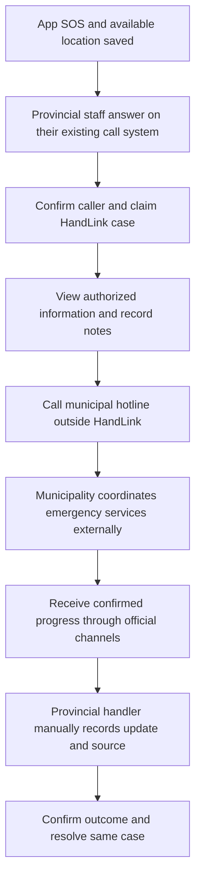
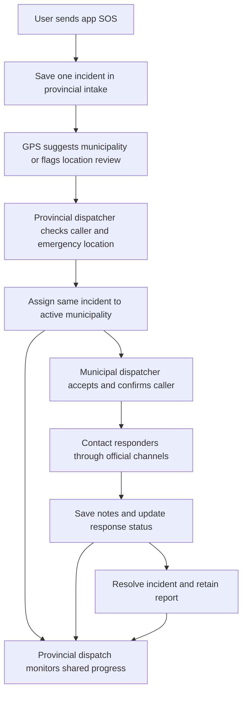
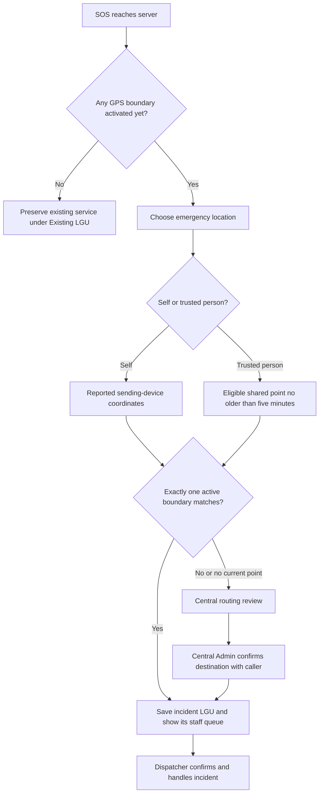

# Multiple LGUs: setup, GPS routing, and access

Implemented locally on 31 October 2026. Production deployment and real jurisdiction boundaries have not been verified.

## Current workflow: provincial case owner, external calls, 4 November 2026

This section supersedes the earlier municipal-handoff design below. The user confirmed the office handles all calls and municipal hotline coordination outside HandLink.

1. A User sends an app SOS, then uses the existing explicit phone-dialer action if needed. HandLink does not answer the call or prove a call was connected.
2. Provincial staff answer through their official call system and locate the associated HandLink incident.
3. A provincial Dispatcher verbally confirms the caller, selects **Confirm caller and handle case**, and becomes the handling dispatcher. This opens the authorized registered information. Only one dispatcher can win confirmation.
4. That dispatcher records additional incident information in notes, contacts the appropriate municipality's official hotline outside HandLink, and verbally relays only needed emergency information.
5. Municipal operations arrange fire/EMS/police response through their own channels. They do not need a HandLink login or an in-app acceptance step.
6. The provincial handler records the contacted office, briefing and acknowledgment in incident notes. Later phone/radio updates remain external communications.
7. Under **Confirmed response updates**, the handler records an On route or Resolved update with **Update confirmed by** and **Confirmed update / outcome**. Save only information actually confirmed; merely placing a call is not departure, arrival or completion.
8. The same provincial handler keeps the case through resolution, reviews any beneficiary cancellation, and can add dated addenda afterward. Original resolved notes stay locked.

**Information boundaries:** Provincial staff/central Admin can monitor operational information; only the case's confirmed handling dispatcher gets its registered personal/medical/contact panels. Municipal staff cannot access provincial cases through their local queues, direct IDs, reports or PDF exports. HandLink does not forward the profile or briefing to them. Both routing endpoints block moving provincial cases to municipal queues. GPS is a location-based municipality suggestion for the provincial operator, not an automatic telephone destination or authority to share an entire medical profile.

**Staff and preservation:** Assign a Dispatcher to **Provincial coordination (system)** through the central Admin's existing Manage accounts page. Email verification, MFA and active-account rules apply. Previously assigned municipal cases and their owners remain unchanged; municipal accounts can finish those earlier cases. Pending provincial cases now remain with provincial dispatch. The saved queue identifies the workflow, so this correction needs no additional schema migration beyond the existing provincial-intake migration `0017`. Deploy server changes consistently; an old server could still transfer a pending case or reject provincial handling. No live deployment, database migration, Git publishing or new APK was performed here.

**Status and evidence:** Database/API values stay Not assigned, In progress, On route and Resolved. For provincial cases the staff UI shows Received and Coordinating for the first two. On-scene information can be entered in notes. Manual status updates require source and details; the incident event records the entering staff and server timestamp. Those are recorded attestations, not automatically verified calls or field telemetry. Updated 5 November 2026: normal resolution requires On route first. Resolution controls are hidden until On route has been saved, and the server rejects attempts to skip departure. Opening the departure form alone does not reveal resolution. This replaces the earlier direct no-response closure shortcut. Approved beneficiary cancellation remains a separate reviewed closure action; do not fabricate a departure to close a no-response case. Normal resolution remains blocked while a beneficiary cancellation request is pending. Alerts/reports show response history, and filtered PDFs include its source/details and recording timestamps. The usual report filters still apply; select All or Resolved to export completed cases.

**Operational scope:** This does not add call answering, telephone/Facebook ingestion, agency messaging, automatic dispatch, responder tracking, or new municipal acceptance requirements. Record municipal acknowledgment and response updates from official communications manually. Admin oversees operations; the assigned provincial dispatcher handles the case.

## Earlier workflow: provincial intake and municipal handoff, 3 November 2026 (historical)

The user approved provincial-first intake and requested implementation. Local source now sends **every new app SOS** to **Provincial coordination (system)**. GPS suggests a municipality; a coordinator makes the assignment. The initial direct-GPS routing descriptions below are historical where they conflict with this update.

**Staff setup:** Use the existing central Admin for provincial oversight. Under **Manage accounts**, create a Dispatcher with LGU **Provincial coordination (system)**, or assign an existing Dispatcher there. Create municipal Admins and Dispatchers under each real municipal LGU. Moving staff ends their sessions and remains blocked while they own unresolved incidents. Provincial dispatchers complete the same verification and MFA requirements as municipal dispatchers. The provincial system queue is permanent, has no geographic boundary, and cannot be edited/deactivated as a municipality. Admin accounts cannot be assigned to it; provincial oversight uses central Admin access.

**Provincial operation:** Sign in at `/login`, open `/dispatch`, and select an SOS. Review the GPS suggestion, reported location, and caller information. For trusted-person SOS, the beneficiary snapshot remains distinct from the reporter's position; never assume they are together. Confirm the caller's name, phone number, and actual emergency location. Choose an active municipality and press **Assign to municipal dispatch**. The incident keeps its original ID/reference. The queue shows **Awaiting municipal acceptance** until a municipal dispatcher chooses **Accept and confirm incident**.

**Monitoring and authority:** Provincial dispatch sees summaries across municipal queues, assignment history, location evidence, municipal notes, and status updates. Filters show awaiting provincial assignment, awaiting municipal acceptance, or accepted cases. Updates refresh every five seconds while visible. Provincial dispatch cannot claim municipal incidents, edit response notes/status, approve AI summaries, manage staff, or access central configuration. The registered medical profile, detailed personal profile and emergency-contact list remain restricted to the assigned municipal dispatcher. Municipal notes/reports can themselves contain sensitive information; only authorized operational staff should receive provincial access.

**Acceptance and concurrency:** Existing atomic confirmation chooses one handling municipal dispatcher. Assignment records who selected the destination and when. Repeating the same still-unaccepted assignment does not duplicate the audit. The new assignment endpoint rejects stale destination changes; both assignment paths reject already claimed/resolved cases. A municipality must have an active LGU; assignment alone does not prove staff have noticed the case. Contact municipal dispatch through official channels and verify acceptance. Reassignment is allowed before municipal acceptance, not after it.

**Preservation and deployment:** Migration `0017_provincial_intake.sql` adds the provincial queue and `incident_intake` table without changing historical incidents, staff, notes, references or owners. `incident_intake` stores the original suggested LGU and suggestion reason. `incident_lgu` remains the current queue; `lgu_routing_audit` records assignment changes. Existing legacy cases stay with their existing staff. New SOS enters provincial intake even before geographic boundaries are configured. Prepare a monitored provincial desk before real use; there is no silent direct-to-municipality fallback.

Deploy the server with its migrations during a controlled cutover. Do not run old direct-routing servers alongside the new provincial workflow. The existing entrypoint backs up the database before migration. No production migration, push, deployment, APK build, or device verification was performed for this update. Before new writes, rollback can restore the protected predeployment backup and matching old server with service stopped. After new incidents exist, prefer a forward fix; never restore an old backup and discard those incidents. Keeping additive tables alone does not make an old server honor provincial-first routing or provincial access rules.

**Limits:** Phone calls and Facebook messages are not automatically received or converted to cases. Manual intake for those channels remains future work. Police/EMS/fire response still uses official external channels. No responder fleet, automatic agency delivery, structured inter-LGU messaging, or accepted-case transfer was added.

The remaining sections preserve initial setup and earlier design discussion. This section supersedes their proposed/unimplemented status for provincial app-SOS intake, municipal assignment/acceptance, and provincial monitoring only.

## Add an LGU when you are ready

GeoJSON is a text file containing the LGU's geographic border as GPS coordinates. HandLink checks whether an emergency location falls inside that border to suggest its municipality to provincial dispatch. A Polygon describes one area; a MultiPolygon supports separated areas such as islands. A Feature wraps a shape with descriptive properties; it is still one boundary input.

The setup fields are: **LGU name** (municipality/city and province), **Import GeoJSON boundary** (choose the file), **Boundary GeoJSON** (the same content shown as editable text), and **Activate this LGU** (enable operational routing). Importing a file fills the text box, so upload and paste are alternatives; two different files are not required. Ask the LGU's planning/GIS office for its official municipality/city boundary as WGS84 GeoJSON. WGS84 is the standard coordinate reference used by GPS. A map screenshot or a single GPS point does not describe the full border.

1. Sign in as a central Admin and complete MFA.
2. Open **LGUs and routing** in the sidebar (`/admin/lgus`).
3. Click **Add LGU**. Enter the municipality/city and province. You can save an inactive draft before obtaining its boundary.
4. Import official GeoJSON, or paste its geometry. Accepted shapes are Polygon, MultiPolygon, a Feature containing either, or a FeatureCollection containing exactly one Feature.
5. Use **Manage accounts** to create or assign that LGU's administrators and dispatchers. Inactive LGUs support staff preparation, but their staff cannot enter the operational workspace until activation. Email verification and MFA still apply.
6. Verify the boundary and staff readiness, then activate the LGU. GPS can now suggest it, and provincial dispatch can assign new SOS incidents to it.

The migration preserves the existing service as **Existing LGU**. Rename it and configure its real boundary if it represents your first participating LGU. No real municipality, province, or national boundary is invented or bundled.

GeoJSON must use WGS84 `[longitude, latitude]` coordinates. Import one LGU at a time. File/request limit is 2 MB; total geometry limit is 10,000 vertices, with closed, non-degenerate rings and valid coordinate ranges. Geometry checks do not establish that a boundary is official or topologically correct. Verify its source, coverage, holes, and overlaps before activation. Unsupported multi-feature collections must be reduced to the intended LGU rather than silently merged.

## Who can do what

| Account       | Access                                                                                                                                                                                               |
| ------------- | ---------------------------------------------------------------------------------------------------------------------------------------------------------------------------------------------------- |
| Central Admin | Manage LGUs and staff assignments; view installation-wide queues/reports and dashboard counts; route unassigned cases manually; manage the global AI provider.                                       |
| LGU Admin     | Manage staff accounts belonging to the assigned LGU; view that LGU's queues/reports and dashboard counts. Cannot access central configuration, other LGUs, or the global civilian account directory. |
| Dispatcher    | See eligible cases in the assigned LGU; confirm and handle cases under existing ownership rules.                                                                                                     |
| User          | Keep one account; send SOS for self or approved trusted people. No manual LGU selection is required.                                                                                                 |

All existing Admins retain their previous global authority as central Admins until a central operator explicitly assigns them to an LGU. Existing dispatchers are assigned to Existing LGU. New staff created through the app always receive an LGU assignment, including new LGU Admins; omitting an LGU cannot promote a local Admin to central access.

Central access does not bypass the assigned-dispatcher restriction on medical/personal incident details. Admins still cannot claim cases as dispatchers. Role, MFA, active-account, and sharing-consent checks remain in force.

Account management shows staff LGUs. Moving a staff account signs out its existing sessions. Moving a dispatcher with unresolved assigned incidents is blocked. Deactivating an LGU with active incidents is also blocked: resolve claimed incidents or use central routing to move unassigned ones first. Deactivation prevents the LGU's staff from entering the operational workspace; it does not delete records.

## Initial GPS routing and earlier coordination discussion (historical)

### Operational coordination recommendation, 2 November 2026

The existing hierarchy supports central oversight, LGU-scoped administrators, and LGU-scoped dispatchers. Geographic routing chooses the responsible incident queue; it does not select the nearest available ambulance, police unit, or fire appliance. Availability, travel time, equipment, and the LGUs' agreed response procedures can matter more than distance to an LGU office.

Recommended initial scope: use HandLink for incident intake, ownership, notes, status, and report history. Dispatchers should coordinate actual response through the agencies' existing authorized phone/radio/dispatch channels. Record the contacted agency, time, accepted response, and updates in the case. The application has no implemented responder fleet, live unit-availability system, or automatic police/EMS/fire job dispatch.

For a border case routed to LGU A, its dispatcher can request assistance from LGU B if an appropriate available unit can respond sooner under their agreed procedures. A request for assistance does not transfer case responsibility. Retain one responsible dispatcher/LGU until another explicitly accepts a handoff; do not duplicate the emergency or automatically transfer it on proximity alone. Exact overlaps, outside points, or uncertain coordinates still use the existing central-review path.

Future in-app cross-LGU coordination should be a structured assistance/handoff workflow with a named destination, acceptance/rejection, ownership history, and controlled information sharing. This is a proposal, not current functionality. Current central manual rerouting applies only to unassigned incidents; it cannot transfer an already claimed case. Existing assigned-dispatcher medical-detail restrictions remain in force. These recommendations require participating LGUs to agree on operational procedures; no such agreement was verified in this discussion.

Before the first boundary is activated, draft setup does not interrupt the existing workflow. The default Existing LGU must remain active for that fallback. After GPS routing has been activated, disabling all boundaries sends new incidents to central review; it does not silently restore legacy routing. Activation history is retained in `lgu.activated_at`.

For self SOS, routing uses the reported device coordinates. For trusted-person SOS, routing uses the beneficiary's latest shared point only if current consent, recipient eligibility, session validity, and five-minute freshness checks pass. It never assumes the caller's position is the trusted person's emergency location. Older eligible points may still be retained as historical report snapshots with their timestamp and accuracy; they do not determine automatic LGU routing.

Polygon holes and MultiPolygon shapes are supported. If multiple active LGUs match, including a shared border, the system does not choose an arbitrary first match. Outside points, overlaps, and unavailable/currently stale beneficiary locations go to central review. GPS reports are device-supplied positions, not proof of physical presence; boundary accuracy and GPS uncertainty still require operational judgment.

The incident's LGU is saved when the incident is created. Later boundary edits and retries do not silently move historical incidents. A central Admin can reroute an **unassigned** incident; each actual move records an audit entry. Assigned/resolved cases cannot be rerouted through this operation.

The central routing page refreshes while visible. Choose **Unrouted incidents** or a particular LGU in its queue filter. Select a destination LGU and route an unassigned case after reviewing its location with the caller. The page shows up to twenty cases at a time; routing and refreshing reveals the next group. New LGUs need staffed monitoring, and central review needs an operator: saving an alert is not proof that someone has responded.

This routing selects the server incident queue. The existing 911 dialer handoff is unchanged; no LGU-specific telephone switching or automatic call placement was added.

## Original provincial main-office proposal, 3 November 2026 (superseded above)

The user clarified that the service should connect a provincial main office with many municipalities. The main office receives emergency calls or Facebook messages and coordinates local response. This is an operational coordination requirement beyond the current central Admin's oversight capabilities.

| Account                           | Proposed responsibility                                                                      |
| --------------------------------- | -------------------------------------------------------------------------------------------- |
| Provincial Admin                  | Oversee participating municipalities, staff, and province-wide reports.                      |
| Provincial dispatcher/coordinator | Receive and check incidents, coordinate municipal assignment, and monitor response progress. |
| Municipal Admin                   | Oversee staff and reports for that municipality.                                             |
| Municipal dispatcher              | Accept responsibility for an incident, contact appropriate responders, and record progress.  |

For example, a provincial dispatcher receives a report about Municipality A. The dispatcher checks the location and coordinates with A. A's dispatcher accepts the incident, contacts the appropriate ambulance, police, or fire service, and records updates. The provincial office monitors the same incident rather than creating a second case. Municipal acceptance and transfer tracking are proposed, not existing features.

Proposed sequence:

1. Receive an app SOS, or have authorized staff manually enter a telephone/Facebook report.
2. Check the emergency details and location. GPS boundaries suggest the responsible municipality; they do not identify the nearest available response unit.
3. Have provincial dispatch coordinate municipal assignment, if provincial-first intake is selected.
4. Record municipal acceptance and retain one accountable owner until a handoff is accepted.
5. Have municipal dispatch contact responders through existing authorized channels and update the shared case.
6. Record completion and retain the incident history for authorized review and reporting.

**Routing choice confirmed:** The user selected provincial-first intake for every app SOS, with GPS suggesting the municipality for assignment. The current source still uses direct GPS-based LGU queue routing, with central review for uncertain routing. Provincial-first intake is the agreed target, not deployed behavior; this explanation did not change routing code.

**Implementation gaps:** Province-wide operational dispatcher access, municipal acceptance/handoff, and manual call/Facebook intake need deliberate implementation. Current central rerouting only moves unassigned cases. There is no automatic 911 call intake, Facebook message integration, or automatic responder dispatch. Provincial coordination must explicitly define who can read personal/medical details; existing assigned-dispatcher restrictions remain unchanged.

## Storage and server enforcement (current implementation)

- `lgu`: name, normalized boundary, active state, first GPS activation time.
- `staff_lgu`: one LGU assignment per scoped staff identity. Admin identities without an assignment are central; dispatchers without a legacy assignment remain restricted to Existing LGU for compatibility.
- `incident_lgu`: saved incident destination and routing reason. An explicit null destination means central review, not legacy access.
- `lgu_routing_audit`: central manual routing changes, actor, source/destination, and timestamp.

The server scopes staff lists, direct-ID detail access, confirmations, status/notes/cancellation updates, addenda, reports, and AI operations. Account lists, activation, and verification requests also enforce local scope. Dashboard counts are scoped; local “People in LGU incidents” counts distinct beneficiaries rather than claiming a resident registry. The global AI provider remains central-only. Disabled Better Auth administration endpoints remain disabled; local staff cannot bypass the custom routes through them.

## Deployment and preservation

Migration `0015_multi_lgu.sql` adds tables and backfills LGU ownership without rewriting existing user, incident, reference, note, medical, or location-snapshot rows. The existing Docker entrypoint runs migrations, then the one-time seed, before starting the server. Its migration script backs up an existing database. No production migration has been run for this work.

Deploy the updated server consistently before configuring multiple LGUs. Do not run old and new application versions together once tenant data is active: older code does not enforce LGU isolation. Leaving additive tables in place is not sufficient to make an old server safe. A rollback must be planned with stopped writes and a protected backup; never discard new incident data casually. Prefer a forward fix after multi-LGU operations have begun.

No secret or private account values belong in boundary files or project records. No credentials, real patient data, or production database rows were used for the automated tests.

## Verification

Focused tests cover geometry, migration preservation, legacy/draft/activation behavior, cross-LGU access and mutations, local account restrictions, central configuration protection, dashboard counts, fresh versus unavailable/stale trusted location, overlaps/outside points, audited manual routing, staff reassignment protection, and mobile GeoJSON upload.

Relevant files: [geometry](../src/lib/lgu.ts), [scope checks](../src/lib/server/lgu-scope.ts), [LGU operations](../src/lib/server/lgus.ts), [migration](../drizzle/0015_multi_lgu.sql), [integration tests](../tests/lgu.api.ts), [geometry tests](../tests/lgu.test.mjs), and [database tests](../tests/database.test.mjs).
