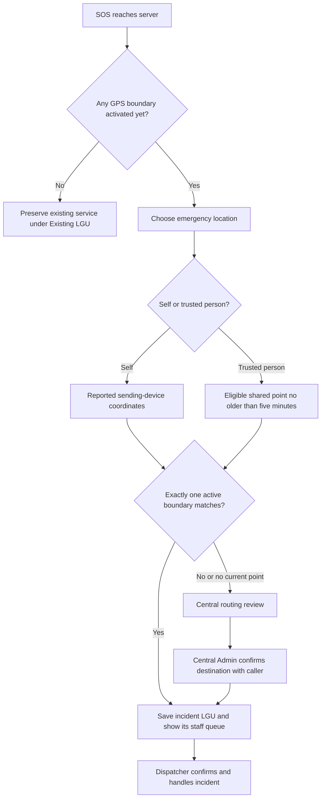

# Multiple LGUs: setup, GPS routing, and access

Implemented locally on 31 October 2026. Production deployment and real jurisdiction boundaries have not been verified.

## Add an LGU when you are ready

1. Sign in as a central Admin and complete MFA.
2. Open **LGUs and routing** in the sidebar (`/admin/lgus`).
3. Click **Add LGU**. Enter the municipality/city and province. You can save an inactive draft before obtaining its boundary.
4. Import official GeoJSON, or paste its geometry. Accepted shapes are Polygon, MultiPolygon, a Feature containing either, or a FeatureCollection containing exactly one Feature.
5. Use **Manage accounts** to create or assign that LGU's administrators and dispatchers. Inactive LGUs support staff preparation, but their staff cannot enter the operational workspace until activation. Email verification and MFA still apply.
6. Verify the boundary and staff readiness, then activate the LGU. New SOS incidents can now route to it.

The migration preserves the existing service as **Existing LGU**. Rename it and configure its real boundary if it represents your first participating LGU. No real municipality, province, or national boundary is invented or bundled.

GeoJSON must use WGS84 `[longitude, latitude]` coordinates. Import one LGU at a time. File/request limit is 2 MB; total geometry limit is 10,000 vertices, with closed, non-degenerate rings and valid coordinate ranges. Geometry checks do not establish that a boundary is official or topologically correct. Verify its source, coverage, holes, and overlaps before activation. Unsupported multi-feature collections must be reduced to the intended LGU rather than silently merged.

## Who can do what

| Account       | Access                                                                                                                                                                                               |
| ------------- | ---------------------------------------------------------------------------------------------------------------------------------------------------------------------------------------------------- |
| Central Admin | Manage LGUs and staff assignments; view installation-wide queues/reports and dashboard counts; route unassigned cases manually; manage the global AI provider.                                       |
| LGU Admin     | Manage staff accounts belonging to the assigned LGU; view that LGU's queues/reports and dashboard counts. Cannot access central configuration, other LGUs, or the global civilian account directory. |
| Dispatcher    | See eligible cases in the assigned LGU; confirm and handle cases under existing ownership rules.                                                                                                     |
| User          | Keep one account; send SOS for self or approved trusted people. No manual LGU selection is required.                                                                                                 |

All existing Admins retain their previous global authority as central Admins until a central operator explicitly assigns them to an LGU. Existing dispatchers are assigned to Existing LGU. New staff created through the app always receive an LGU assignment, including new LGU Admins; omitting an LGU cannot promote a local Admin to central access.

Central access does not bypass the assigned-dispatcher restriction on medical/personal incident details. Admins still cannot claim cases as dispatchers. Role, MFA, active-account, and sharing-consent checks remain in force.

Account management shows staff LGUs. Moving a staff account signs out its existing sessions. Moving a dispatcher with unresolved assigned incidents is blocked. Deactivating an LGU with active incidents is also blocked: resolve claimed incidents or use central routing to move unassigned ones first. Deactivation prevents the LGU's staff from entering the operational workspace; it does not delete records.

## How GPS routing works

Before the first boundary is activated, draft setup does not interrupt the existing workflow. The default Existing LGU must remain active for that fallback. After GPS routing has been activated, disabling all boundaries sends new incidents to central review; it does not silently restore legacy routing. Activation history is retained in `lgu.activated_at`.

For self SOS, routing uses the reported device coordinates. For trusted-person SOS, routing uses the beneficiary's latest shared point only if current consent, recipient eligibility, session validity, and five-minute freshness checks pass. It never assumes the caller's position is the trusted person's emergency location. Older eligible points may still be retained as historical report snapshots with their timestamp and accuracy; they do not determine automatic LGU routing.

Polygon holes and MultiPolygon shapes are supported. If multiple active LGUs match, including a shared border, the system does not choose an arbitrary first match. Outside points, overlaps, and unavailable/currently stale beneficiary locations go to central review. GPS reports are device-supplied positions, not proof of physical presence; boundary accuracy and GPS uncertainty still require operational judgment.

The incident's LGU is saved when the incident is created. Later boundary edits and retries do not silently move historical incidents. A central Admin can reroute an **unassigned** incident; each actual move records an audit entry. Assigned/resolved cases cannot be rerouted through this operation.

The central routing page refreshes while visible. Choose **Unrouted incidents** or a particular LGU in its queue filter. Select a destination LGU and route an unassigned case after reviewing its location with the caller. The page shows up to twenty cases at a time; routing and refreshing reveals the next group. New LGUs need staffed monitoring, and central review needs an operator: saving an alert is not proof that someone has responded.

This routing selects the server incident queue. The existing 911 dialer handoff is unchanged; no LGU-specific telephone switching or automatic call placement was added.

## Storage and server enforcement

- `lgu`: name, normalized boundary, active state, first GPS activation time.
- `staff_lgu`: one LGU assignment per scoped staff identity. Admin identities without an assignment are central; dispatchers without a legacy assignment remain restricted to Existing LGU for compatibility.
- `incident_lgu`: saved incident destination and routing reason. An explicit null destination means central review, not legacy access.
- `lgu_routing_audit`: central manual routing changes, actor, source/destination, and timestamp.

The server scopes staff lists, direct-ID detail access, confirmations, status/notes/cancellation updates, addenda, reports, and AI operations. Account lists, activation, and verification requests also enforce local scope. Dashboard counts are scoped; local “People in LGU incidents” counts distinct beneficiaries rather than claiming a resident registry. The global AI provider remains central-only. Disabled Better Auth administration endpoints remain disabled; local staff cannot bypass the custom routes through them.

## Deployment and preservation

Migration `0015_multi_lgu.sql` adds tables and backfills LGU ownership without rewriting existing user, incident, reference, note, medical, or location-snapshot rows. The existing Docker entrypoint runs migrations, then the one-time seed, before starting the server. Its migration script backs up an existing database. No production migration has been run for this work.

Deploy the updated server consistently before configuring multiple LGUs. Do not run old and new application versions together once tenant data is active: older code does not enforce LGU isolation. Leaving additive tables in place is not sufficient to make an old server safe. A rollback must be planned with stopped writes and a protected backup; never discard new incident data casually. Prefer a forward fix after multi-LGU operations have begun.

No secret or private account values belong in boundary files or project records. No credentials, real patient data, or production database rows were used for the automated tests.

## Verification

Focused tests cover geometry, migration preservation, legacy/draft/activation behavior, cross-LGU access and mutations, local account restrictions, central configuration protection, dashboard counts, fresh versus unavailable/stale trusted location, overlaps/outside points, audited manual routing, staff reassignment protection, and mobile GeoJSON upload.

Relevant files: [geometry](../src/lib/lgu.ts), [scope checks](../src/lib/server/lgu-scope.ts), [LGU operations](../src/lib/server/lgus.ts), [migration](../drizzle/0015_multi_lgu.sql), [integration tests](../tests/lgu.api.ts), [geometry tests](../tests/lgu.test.mjs), and [database tests](../tests/database.test.mjs).
